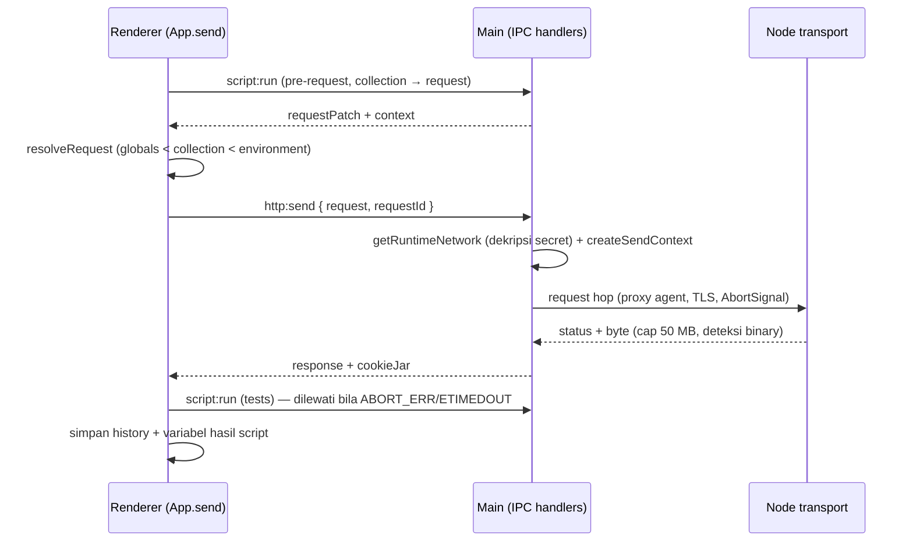

# Relay — Architecture

Dokumen ini menjelaskan batas proses, kontrak IPC, alur request, dan
persistensi Relay sesuai kode saat ini. Perbarui bila kontrak IPC atau
kebijakan jaringan berubah.

## Model proses

| Proses | Isi | Batasan |
|---|---|---|
| Renderer (`src/`) | React UI. Tidak punya akses Node. | CSP: `script-src 'self' 'unsafe-eval'` (Monaco), `img-src 'self' data:`, `frame-src 'self' data:` |
| Preload (`electron/preload.cjs`) | Jembatan `contextBridge` → `window.api` | CommonJS, hanya `ipcRenderer.invoke` |
| Main (`electron/`) | Window, request engine, cookie jar, network settings, script runtime, file I/O | Satu-satunya proses yang menyentuh disk/jaringan |

`contextIsolation: true`, `nodeIntegration: false`. Renderer tidak pernah
mengimpor `electron/*`; semua efek samping lewat IPC.

## Kontrak IPC

| Channel | Payload | Hasil |
|---|---|---|
| `http:send` | `{ request, requestId }` | Response object (lihat bawah) atau `{ ok:false, error, timeMs }` |
| `http:abort` | `requestId` | `true` bila dibatalkan, `false` bila id tak dikenal |
| `script:run` | `{ phase, script, response?, context, request? }` | `{ ran, results, logs, error?, context, requestPatch }` |
| `oauth2:token` | config OAuth2 | `{ ok, accessToken, refreshToken, expiresAt, tokenType, raw, error }` (hasil di-cache) |
| `oauth2:authorize` | config OAuth2 | Authorization Code + PKCE via loopback + browser; `{ ok, accessToken, … }` |
| `oauth2:status` | config OAuth2 | `{ hasToken, expiresAt }` — token tidak pernah dikirim balik |
| `cookies:get` / `cookies:clear` | — | daftar cookie / `[]` |
| `file:pick` | — | `{ filePath, fileName, size }` atau `null` |
| `response:save` | `{ suggestedName, base64? \| text? }` | `{ saved, path?, error? }` |
| `network:get` / `network:set` | settings tersanitasi / edit | settings tersanitasi (rahasia diganti flag) |
| `store:get` / `store:set` | data workspace | data workspace |

Bentuk response engine:

```js
{
  ok: true, status, statusText, headers: [{key,value}], cookies: [...],
  body,            // '' untuk binary
  bodyBase64,      // byte asli untuk binary
  isBinary, charset, size, contentType, finalUrl, redirects,
  tlsInsecure,     // true bila verifyTls dimatikan
  sent: { method, url, headers, body },
  timeMs, cookieJar
}
```

Kegagalan transport selalu berupa `{ ok: false, error, code, timeMs }` —
tidak pernah rejection IPC, kecuali bug internal. `code` berisi
`ABORT_ERR` / `ETIMEDOUT` untuk pembatalan.

## Alur satu kali Send



`createSendContext` (`electron/network-runtime.js`) memiliki satu
`AbortController` + timer timeout, dan selalu diberi `cleanup()` di `finally`.
`http:abort` memanggil `ctx.abort()` dari `Map<requestId, ctx>`; request yang
sudah selesai tidak ditemukan dan menghasilkan `false`.

## Kebijakan jaringan

Presedensi per field: **request → app setting → bawaan**.

| Field | Bawaan | Catatan |
|---|---|---|
| `timeoutMs` | 30000 (1..3600000) | Engine tidak punya timeout sendiri; seluruhnya lewat AbortSignal |
| `followRedirects` / `maxRedirects` | true / 5 (0..50) | 3xx dikembalikan apa adanya bila dimatikan |
| `verifyTls` | true | `false` → `rejectUnauthorized:false` + badge “TLS verification off” |
| `proxyId` | `null` = ikut mode app | `'none'` = paksa direct |
| `useCookieJar` | true | `false` = tidak membaca & tidak menulis jar untuk request itu |
| `maxResponseBytes` | 50 MB | Melebihi cap = error, bukan respons terpotong |

Proxy: `request proxyId` → mode `manual` (`activeProxyId`) → mode
`environment` (`HTTPS_PROXY`/`HTTP_PROXY`/`NO_PROXY`) → direct. Bypass
mendukung `*`, `.suffix`, `*.suffix`. Profil tanpa host atau id yang hilang =
direct, bukan error. URL proxy dan kredensial tidak pernah di-log.

TLS: `ca`, `cert`, `key`, `passphrase`, `servername` dibaca/diisi di
`buildTlsOptions` sebelum timer dibuat, sehingga path file yang salah gagal
cepat sebagai `{ ok:false, error: "Cannot read TLS file ..." }`.

## Auth providers

Semua auth diselesaikan di main (`electron/auth/`), bukan di renderer:

- `providers.js` — registry sinkron per tipe (`bearer`, `basic`, `apikey`, `oauth1`, `oauth2`, `digest`, `ntlm`, `awsv4`, `jwt`) dengan `buildHeaders`/`buildQuery`, plus MD4/NTLMv2 sendiri karena OpenSSL 3 menolak `md4`.
- `oauth2.js` — Authorization Code + PKCE S256, loopback `127.0.0.1:0` (validasi `state`, single-use, timeout), exchange & refresh dengan fetcher yang bisa diinjeksi.
- `token-cache.js` — cache in-memory per hash config + expiry/refresh (persistensi terenkripsi: Fase 3.4).
- `index.js` — `resolveAuth()` (dipakai engine; menyegarkan token OAuth2 kedaluwarsa), `authorizeOAuth2()`, `getOAuth2Status()`.

Engine memanggil auth **setelah** URL dan body terbentuk (OAuth1/AWS SigV4 menandatangani keduanya) dan mengulang tepat sekali saat 401 dengan `www-authenticate` untuk Digest/NTLM. Token/kredensial tidak pernah di-log.

## Import/export

- Postman v2.1: `src/lib/postmanFormat.js` — event di tiga level, `examples` ↔ `item.response[]`, `pathVars` ↔ `url.variable[]`, form-data file + content type, seluruh tipe auth, globals & workspace backup (`_relayBackup` v1).
- Format lain: `src/lib/import/` — `openapi.js` (OpenAPI 3/Swagger 2), `har.js`, `curl.js`, `insomnia.js`, dan `index.js` (`detectFormat`/`importAs`/`importAny`).

## Rahasia

`safeStorage` adalah satu-satunya penyimpanan rahasia. Password proxy dan
passphrase client cert dienkripsi di main, disimpan sebagai ciphertext base64
(`passwordEnc`, `clientCertPassphraseEnc`), dan tidak pernah dikirim balik ke
renderer — `sanitizeNetworkSettings` menggantinya dengan
`hasPassword` / `hasClientCertPassphrase`. Bila `safeStorage` tidak tersedia
(termasuk backend Linux `basic_text`), penyimpanan rahasia gagal dengan pesan
jelas; tidak ada fallback plaintext.

## Persistensi

File data: `<userData>/rest-tamer-data.json` (fallback folder lama
`rest-tamer/` bila ada), ditulis atomik (`*.tmp` + rename) dengan salinan
`*.bak` setiap penulisan.

Bentuk saat ini (`SCHEMA_VERSION = 2` di `shared/schema.js`):

```
{ schemaVersion, workspaces: [...], activeWorkspaceId, cookieJar, network }
```

- Renderer hanya mengelola `workspaces` + `activeWorkspaceId`.
- Main memiliki `cookieJar` dan `network`; `store.setAll` mempertahankan
  keduanya bila payload renderer tidak menyertakannya.
- Sebelum migrasi, main menyalin file ke `<file>.v<versiLama>.bak` sekali
  (tidak menimpa backup yang sudah ada, dan tidak membuat apa pun pada
  instalasi baru).

## Runtime script

Script pre-request/test dijalankan di main (`electron/script-runner.js`),
bukan di renderer: script butuh `require('crypto-js'|'moment'|'uuid')` dan
tidak boleh menyentuh DOM aplikasi. `runScript` menerima `send` dari main
sehingga `pm.sendRequest` memakai cookie jar + network policy yang sama. Script dapat me-require `crypto-js`, `moment`, `uuid`; mutasi variabel
dikembalikan lewat `context`, mutasi request lewat `requestPatch`.

## Testing dan CI

- Unit (`test/unit`, Vitest, environment Node): modul pure + engine dengan
  server HTTP/HTTPS lokal, mock IdP, dan fixture TLS di `test/fixtures/tls`.
- E2E (`e2e`, Playwright `_electron`): build produksi (`npm run build:vite`)
  dijalankan dengan `RELAY_TEST_USER_DATA` ke direktori sementara; mencakup
  network/TLS/stop, impor lima format, dan UI auth.
- Gate lokal: `npm run check` (lint → unit → build).
- `.github/workflows/ci.yml`: lint + unit + build di ubuntu, e2e di macOS.
- `.github/workflows/build.yml`: `electron-builder --mac --arm64` setiap push,
  artifact `relay-macos-arm64` (dmg) dapat diunduh; tag `v*` membuat GitHub
  Release dengan dmg terlampir.
