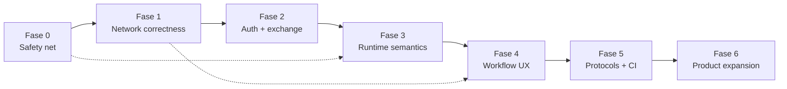

# Relay — Roadmap Parity Postman

Status: draft v1 — 2026-10-26  
Baseline: Relay 0.1.0 (Electron 33 + React 18 + Vite 5), ±7.1k LOC  
Tujuan: menutup gap fungsional terhadap Postman untuk kebutuhan API client harian, tanpa mengorbankan keamanan dan keandalan data.

## Prinsip

1. **Local-first.** Cloud sync bukan prasyarat; jangan menunda perbaikan inti karena fitur kolaborasi.
2. **Correctness > jumlah fitur.** Response binary, TLS, abort, dan variable precedence harus benar sebelum menambah protokol.
3. **Tidak ada data loss.** Setiap perubahan bentuk data wajib punya `schemaVersion` + migrasi + backup.
4. **P0 wajib punya test otomatis.** Tidak ada fase P0 yang dianggap selesai hanya karena manual test.
5. **Reuse arsitektur yang ada.** Ekstraksi `core/` hanya dilakukan saat CLI/headless benar-benar dibutuhkan.
6. **Fitur berisiko keamanan default aman.** Script dari collection import tidak boleh otomatis mendapat akses Node penuh.

## Gap Register

Prioritas: **P0** = blocker pemakaian nyata, **P1** = parity penting, **P2** = perlu decision gate / produk lanjutan.  
Fase mengacu ke rencana di bawah.

| ID | Gap | Prioritas | Fase | Dampak | Bukti kode |
|---|---|---|---|---|---|
| G-01 | TLS verification toggle, custom CA, client certificate (mTLS) | P0 | 1 | API lokal HTTPS self-signed dan API dengan mTLS tidak bisa dipakai | `electron/request-engine.js` memakai default `https.request`; tidak ada setting TLS |
| G-02 | Proxy HTTP/HTTPS/SOCKS + bypass list | P0 | 1 | Tidak bisa dipakai di lingkungan korporat/proxy | Tidak ada agent/proxy di engine maupun UI |
| G-03 | Cancel request + timeout per request/global | P0 | 1 | Request macet terkunci sampai 30 detik; tidak bisa dihentikan | Timeout default 30000 di engine; tidak ada IPC abort |
| G-04 | Binary response, preview, save/download | P0 | 1 | Gambar/PDF/ZIP rusak karena selalu decode UTF-8 | `body: raw.toString('utf8')`; `ResponsePanel` hanya pretty/raw/HTML |
| G-05 | Auth lengkap: OAuth2 auth code + PKCE + refresh, OAuth1, Digest, NTLM, AWS SigV4, JWT | P0 | 2 | Banyak API enterprise tidak bisa diakses; token OAuth2 harus diisi manual | `AuthPanel.jsx` hanya none/bearer/basic/apikey/oauth2 client_credentials+password |
| G-06 | Import/export lossless Postman v2.1 | P0 | 2 | Script pre-request, examples, path vars, dan file form-data hilang saat round-trip | `postmanFormat.js` hanya memproses event `test`; form-data selalu `type: "text"` |
| G-07 | Import OpenAPI/Swagger, HAR, cURL, Insomnia | P1 | 2 | Harus membuat request manual dari spec | Hanya import collection/environment Postman v2.1 |
| G-08 | Variable precedence + local scope + data runner | P0 | 3 | Data file tidak bisa override environment; `pm.variables.set` menulis scope salah; hasil test berbeda dari Postman | `runner.js` menyusun `{...iterationData, ...globals, ...collection, ...environment}` |
| G-09 | Inheritance auth/script per folder | P0 | 3 | Tidak bisa menerapkan auth/script ke satu folder saja | `collectionTree.js` folder hanya `{id,type,name,items}`; `inheritance.js` hanya collection |
| G-10 | Script isolation + pm API parity | P0 | 3 | Script import berjalan dengan akses Node; berisiko RCE. Banyak `pm.*` dan library tidak tersedia | `script-runner.js` `new Function` + Proxy ke `globalThis`; `expect` subset |
| G-11 | Dynamic variables + secret variables | P1 | 3 | Tidak ada `{{$guid}}`, `{{$timestamp}}`, `{{$random*}}`; secret tersimpan plaintext | `variables.js` hanya `{{name}}`; data JSON plaintext |
| G-12 | Runner: stop, retry, conditional flow, report export | P1 | 4 | Run panjang tidak bisa dihentikan; hasil tidak bisa dipakai di CI | `runner.js` loop tanpa abort; `RunnerModal.jsx` tanpa stop/export |
| G-13 | Response UX: syntax highlight, JSON tree, search, XML pretty, preview image/PDF, save, redirect/timing | P1 | 4 | Response besar sulit dibaca; binary tidak bisa disimpan | `ResponsePanel.jsx` memakai `<pre>` dan iframe HTML saja |
| G-14 | Cookie manager CRUD + per-request jar toggle | P1 | 4 | Cookie hanya bisa dilihat/dihapus semua | `CookiesModal.jsx` hanya lihat + Clear All |
| G-15 | History search/filter/delete/grouping/retention | P1 | 4 | History 100 entri tanpa pencarian; sulit menemukan request lama | `useStore.js` `slice(0, 100)`; `Sidebar.jsx` tanpa filter history |
| G-16 | Protokol WebSocket, gRPC, MQTT, Socket.IO; GraphQL introspection | P1 | 5 | Hanya HTTP; tidak bisa test realtime/RPC | `request-engine.js` hanya `node:http`/`node:https` |
| G-17 | Codegen lebih banyak bahasa | P1 | 5 | Snippet tidak cocok dengan stack pengguna | `codegen.js` hanya cURL/fetch/Python/HTTPie |
| G-18 | CLI/headless runner + CI integration | P1 | 5 | Tidak ada ekuivalen Newman/Postman CLI | Hanya UI runner |
| G-19 | Collaboration/cloud sync/sharing/comments | P2 | 6 | Semua data lokal; tidak ada kerja tim | Workspace lokal di JSON |
| G-20 | Mock server, generated docs, monitor terjadwal, performance test | P2 | 6 | Tidak ada alat pendukung API lifecycle | Tidak ada modul terkait |
| G-21 | Build Windows/Linux, signing/notarization, auto-update | P1 | 5 | Distribusi hanya macOS | `package.json` build hanya `mac`, script `--mac` |
| G-22 | Session/tab restore, unsaved-close guard, shortcut map | P1 | 4 | Tab hilang saat restart; perubahan unsaved bisa hilang | `App.jsx` selalu mulai dengan satu tab baru; tidak ada `beforeunload` |
| G-23 | Test harness, lint, CI, dokumentasi arsitektur | P0 | 0 | Regresi tidak terdeteksi; refactor berisiko | `package.json` tidak punya `test`/`lint` |

## Peta Dependensi Fase



Fase 1 dan 2 boleh berjalan paralel setelah Fase 0 selesai, tetapi **response binary dan auth tidak boleh dirilis sebelum test integrasi TLS/abort ada**.

## Fase 0 — Safety Net

Tujuan: membuat perubahan P0 bisa diverifikasi dan data lama aman.

- [x] Tambah Vitest untuk unit test `src/lib` dan `electron/*` yang pure.
- [x] Tambah Playwright Electron smoke test minimal: launch app, kirim request ke server lokal, cek response.
- [x] Tambah ESLint minimal (`@eslint/js`, `eslint-plugin-react-hooks`) dan script `npm run lint`.
- [x] Tambah script `npm test`, `npm run test:e2e`, `npm run check` di `package.json`.
- [x] Buat fixture: Postman collection dengan pre-request/examples/path vars/file, environment, CSV data, OpenAPI Petstore, HAR, cURL. — lengkap: `test/fixtures/{postman,import,data,environment}/**` (+ Insomnia v4, Swagger 2, cURL auth/file).
- [x] Tambah `schemaVersion` di data store dan fungsi `migrateWorkspaces(data)`.
- [x] Pastikan migrasi tidak menghapus field lama; buat backup `.bak` sebelum migrasi. — `.bak` ditulis tiap persist; main juga menyalin `<file>.vN.bak` sekali sebelum migrasi. Field asing di level workspace dipertahankan, collection dinormalisasi.
- [x] Tambah GitHub Actions: install, lint, unit test, build Vite (macOS runner dulu). — `.github/workflows/ci.yml` (unit di ubuntu, e2e di macOS) + `build.yml` (dmg artifact/release).
- [x] Tulis `ARCHITECTURE.md` singkat: renderer/main boundary, IPC, alur request, script runtime, persistence.

**Acceptance:** `npm run check` hijau di CI; data lama tetap terbuka; ada smoke test yang benar-benar mengirim HTTP request.

## Fase 1 — Network Correctness

Tujuan: request bisa dipercaya untuk API nyata, termasuk localhost HTTPS, proxy, dan response binary.

### 1.1 Request settings dan schema

- [x] Tambah `request.settings` di `factory.js`:
  ```js
  {
    timeoutMs: 30000,
    followRedirects: true,
    maxRedirects: 5,
    verifyTls: true,
    proxyId: null,
    useCookieJar: true
  }
  ```

  _Catatan implementasi: shape-nya sparse — `null` = inherit app setting; `useCookieJar` ditambahkan (default `true`)._
- [x] Tambah app-level network settings: proxy profiles, custom CA, client certificate, default timeout.
- [x] Normalisasi di `normalizeRequest()` agar data lama otomatis mendapat default.
- [x] UI: gear di samping URL atau tab “Settings” untuk override per request.

### 1.2 TLS / proxy

- [x] Engine menerima `verifyTls`, `ca`, `cert`, `key`, `passphrase`, `servername`.
- [x] Gunakan `rejectUnauthorized: false` hanya jika user memilih insecure; tampilkan warning di UI.
- [x] Tambah agent proxy: `http-proxy-agent`, `https-proxy-agent`, `socks-proxy-agent`.
- [x] Hormati environment `HTTP_PROXY`/`HTTPS_PROXY`/`NO_PROXY` sebagai default opsional. — mode `environment` (opt-in); belum ada auto-detect proxy OS.
- [x] Jangan log kredensial proxy/client cert.

### 1.3 Abort dan timeout

- [x] Beri `requestId` unik per pengiriman dari renderer.
- [x] Simpan `ClientRequest` aktif di `Map<requestId, req>` pada main process. — peta menyimpan send-context (AbortController + cleanup), bukan `ClientRequest` mentah.
- [x] IPC `http:abort` → destroy request dan lepas socket.
- [x] Engine menerima `AbortSignal`; semua redirect harus ikut abort.
- [x] UI: tombol Send berubah menjadi Stop saat `sending`; Stop membatalkan tepat satu request.
- [x] Timeout per request + default global; error message menyebut nilai timeout.

### 1.4 Binary response

- [x] Deteksi binary berdasarkan `content-type` dan validitas UTF-8.
- [x] Return `{ body, bodyBase64, isBinary, charset }`; jangan decode binary ke string.
- [x] IPC `response:save` memakai `dialog.showSaveDialog` + tulis byte asli.
- [x] Response tab: preview image/PDF, tombol Save/Download, tampilkan ukuran asli.
- [x] Batasi ukuran response di memori (mis. 50 MB) dan beri error yang jelas.

**Acceptance Fase 1:**
- HTTPS self-signed gagal saat verify ON dan berhasil saat OFF.
- mTLS berhasil dengan client cert valid.
- Request 60 detik bisa dihentikan < 1 detik.
- Response PNG disimpan byte-identik (SHA-256 sama).
- Tidak ada socket leak setelah abort/timeout.

## Fase 2 — Auth + Exchange

Tujuan: API dengan auth standar dan proses pindah dari/tim Postman tidak kehilangan data.

### 2.1 Auth architecture

- [x] Refactor auth menjadi provider di main process: `buildAuthHeaders()`, `buildAuthQuery()`, `refresh()`. — `electron/auth/{providers,oauth2,token-cache,index}.js`; engine memakai `resolveAuth()` async (signing butuh URL+body), retry 401 sekali untuk Digest/NTLM.
- [x] Token cache per auth config + expiry, disimpan aman (lihat 3.4). — cache in-memory per hash config + expiry/refresh; **belum dipersist** terenkripsi (menunggu 3.4).
- [x] Tambah tipe: OAuth1, Digest, NTLM, AWS SigV4, JWT.
- [x] Tiap provider punya test vector sendiri. — RFC 5849, RFC 7616 (MD5/SHA-256), MS-NLMP §4.2.4, AWS `get-vanilla` SigV4, jwt.io HS256 + RS256, RFC 7636 PKCE.

### 2.2 OAuth 2.0 lengkap

- [x] Authorization Code + PKCE: loopback server `127.0.0.1` port acak, `state` validation, `shell.openExternal`. — `oauth2:authorize` + loopback single-use, 120 s timeout, PKCE S256; diuji terhadap mock IdP.
- [x] Client Credentials dan Password tetap didukung.
- [x] Refresh token otomatis saat expired; tampilkan status token. — refresh sebelum kirim (skew 30 s) + status/expiry di AuthPanel; `oauth2:status` tidak pernah mengembalikan token.
- [x] Dukungan `scope`, `audience`, `clientAuth` (body/basic), dan custom parameter.
- [x] Jangan simpan token di log/console.

### 2.3 Import/export fidelity

- [x] Export `event` pre-request **dan** test untuk request, folder, collection.
- [x] Import `event` pre-request request-level (saat ini hanya test).
- [x] Export/import `examples` ke `item.response[]` Postman (termasuk `originalRequest`). — round-trip memakai `_relayId`/`_relaySavedAt`/`_relayContentType` agar tidak ada field hilang.
- [x] Export/import `pathVars` ke `url.variable[]`.
- [x] Export/import form-data file (`type: "file"`, `src`) dan content type per field.
- [x] Pertahankan `description` request/folder.
- [x] Tambah export globals dan workspace-level backup. — `toPostmanGlobals`/`fromPostmanGlobals` + `toWorkspaceBackup`/`fromWorkspaceBackup` (`_relayBackup` v1).
- [x] Perbaiki penggabungan URL + query agar tidak menghasilkan `?` ganda. — dedupe raw vs `params` dua arah, tidak ada `??`/`&&`.

_Catatan tambahan: seluruh tipe auth baru ikut di-export/import (`bearer/basic/apikey/oauth1/oauth2/digest/ntlm/awsv4/jwt`); field yang tidak punya slot di Postman (`oauth2.extraParams`, `clientAuth`, `redirectUri`, `codeVerifier`, dll.) hanya bertahan di backup Relay, bukan di file Postman._

### 2.4 Format import tambahan

- [x] OpenAPI 3 / Swagger 2 → collection. Evaluasi `openapi-to-postmanv2`; jika tidak cocok, konverter minimal. — konverter minimal tanpa dependency: tag→folder, `{id}`→`:id`, `$ref` 1 level, auth dari security scheme.
- [x] HAR → collection.
- [x] cURL → request (evaluasi `curlconverter`). — parser sendiri: `-X/-H/-d/-F/-u/-b/-G/--json/--data-urlencode`, quote + line continuation.
- [x] Insomnia export → collection.
- [x] Deteksi format otomatis di satu tombol Import. — `detectFormat`/`importAny` + environment ikut terimpor; e2e menutup kelima format.

**Acceptance Fase 2:**
- Round-trip Postman v2.1 mempertahankan script, examples, path vars, file fields (golden fixture).
- OAuth2 auth code + PKCE berhasil terhadap mock IdP lokal; refresh berjalan otomatis.
- AWS SigV4 cocok dengan test vector resmi.
- Import OpenAPI Petstore menghasilkan collection yang bisa dijalankan.

## Fase 3 — Runtime Semantics

Tujuan: script, variable, dan inheritance berperilaku seperti Postman serta tidak menjadi lubang keamanan.

### 3.1 Script isolation (spike + implementasi)

- [ ] Spike 2–3 hari: bandingkan `isolated-vm`, `quickjs-emscripten`, dan `utilityProcess` + `vm`.
- [ ] Kriteria: dukungan async `pm.sendRequest`, kompatibilitas crypto-js/moment/uuid, packaging macOS universal, batas memori/CPU.
- [ ] Rekomendasi awal: `utilityProcess` + `vm` hardening untuk v1; `isolated-vm` jika untrusted import masuk scope.
- [ ] Larang `process`, `require`, `fs`, `child_process`, `globalThis` escape, dan akses network langsung.
- [ ] Timeout per script (mis. 5 detik) dan batas output console.
- [ ] Default: script dari collection import berjalan dengan peringatan; opsi “trust this collection”.

### 3.2 pm API parity

- [ ] `pm.response`: `code`, `status`, `responseTime`, `headers.get`, `json()`, `text()`, `to.have.*`.
- [ ] `pm.request`: URL/query/header/body mutation yang lengkap.
- [ ] `pm.execution.setNextRequest()` dan `skipRequest()`.
- [ ] `pm.variables.replaceIn()`, `pm.iterationData.set()`.
- [ ] `pm.cookies`, `pm.visualizer` (minimal), legacy `postman.*` aliases.
- [ ] Library: chai-style expect yang lebih lengkap, lodash, ajv/tv4, cheerio/xml2json sesuai kebutuhan.
- [ ] `pm.sendRequest` tetap satu-satunya jalur network dari sandbox.

### 3.3 Scope dan inheritance

- [ ] Tambah scope `local` per eksekusi.
- [ ] Precedence final: `local > iterationData > environment > collection > globals`.
- [ ] `pm.variables` memakai local; `pm.environment`/`pm.collectionVariables`/`pm.globals` eksplisit.
- [ ] Runner: data file harus menang atas environment.
- [ ] Folder mendapat `auth`, `preRequest`, `tests`; request mewarisi ancestor terdekat.
- [ ] Script order: collection → folder → request.
- [ ] (Opsional, bukan parity Postman) folder variables; dokumentasikan sebagai extension jika dibuat.

### 3.4 Secrets dan dynamic variables

- [ ] Tipe variabel `default | secret`; secret dimask di UI, log, dan export.
- [ ] Enkripsi secret dengan Electron `safeStorage` di main process; fallback dengan warning jika tidak tersedia.
- [ ] Migrasi variabel lama sebagai `default`.
- [ ] Dynamic variables: `{{$guid}}`, `{{$timestamp}}`, `{{$randomInt}}`, `{{$randomFirstName}}`, `{{$randomEmail}}`, `{{$isoTimestamp}}`.
- [ ] Resolusi dynamic variable terjadi sebelum lookup environment; token tidak dikenal dibiarkan + warning.

**Acceptance Fase 3:**
- Script tidak bisa membaca `process`, `require`, filesystem, atau network langsung (escape suite).
- Matriks precedence lulus untuk semua kombinasi scope.
- Data runner menang atas environment.
- Folder auth/script diwarisi oleh request di dalamnya.
- Secret tidak muncul plaintext di log/export.

## Fase 4 — Workflow UX

Tujuan: alur harian secepat Postman dan hasil run bisa dipakai di CI.

### 4.1 Runner

- [ ] Tombol Stop; abort request aktif dan hentikan iterasi berikutnya.
- [ ] Retry N kali dengan delay; status retry di report.
- [ ] Conditional flow via `pm.execution.setNextRequest`.
- [ ] Opsi “stop on error”, “save responses”, “keep variable values”.
- [ ] Export report JSON, JUnit XML, HTML.
- [ ] Simpan konfigurasi run terakhir (iterations, delay, data file path).

### 4.2 Response viewer

- [ ] Monaco read-only untuk JSON/XML/JS/HTML dengan syntax highlight.
- [ ] JSON tree collapsible + search/filter path.
- [ ] Pretty XML.
- [ ] Preview image/PDF/binary + save/download.
- [ ] Tampilkan redirect chain dan timing breakdown (DNS/TLS/TTFB/total) bila tersedia.
- [ ] Copy body/headers; cari teks di response.

### 4.3 Cookies dan history

- [ ] Cookie CRUD (add/edit/delete per cookie).
- [ ] Toggle “use cookie jar” per request/run.
- [ ] History: search, filter method/status, hapus per item, grouping tanggal, retensi configurable.
- [ ] Opsional: simpan response history dengan batas ukuran.

### 4.4 Session

- [ ] Persist tab terbuka dan request unsaved di localStorage/IndexedDB.
- [ ] Guard `beforeunload` saat ada tab dirty; prompt simpan/discard.
- [ ] Shortcut: Cmd/Ctrl+Enter send, Cmd/Ctrl+S save, Cmd/Ctrl+W close tab, Cmd/Ctrl+K search.
- [ ] Restore split pane dan tab terakhir.

**Acceptance Fase 4:**
- Run 100 request bisa dihentikan dan tidak ada request baru setelah Stop.
- Report JUnit valid dan bisa dibaca CI.
- Response 5 MB tetap responsif; image/PDF tampil.
- Restart app memulihkan tab; close dengan dirty menampilkan prompt.

## Fase 5 — Protocols + Automation

Tujuan: menutup gap protokol dan menyediakan jalur CI.

- [ ] Abstraksi `ProtocolAdapter` di core; HTTP tetap default.
- [ ] WebSocket: connect, headers, message history, close, binary frames.
- [ ] gRPC: proto upload, unary + server streaming, reflection jika memungkinkan.
- [ ] MQTT: connect/publish/subscribe, QoS.
- [ ] Socket.IO: connect/emit/listen.
- [ ] GraphQL: schema introspection + autocomplete di editor.
- [ ] Codegen: axios, Go, Java, C#, PHP, Ruby, Swift, Kotlin; evaluasi `httpsnippet`.
- [ ] Ekstrak `packages/core` (request engine, variables, runner, import/export) agar bisa dipakai CLI.
- [ ] CLI: `relay run collection.json -e env.json -d data.csv --report junit`.
- [ ] CI: matrix macOS/Windows/Linux; build artifact; signing/notarization; auto-update channel.
- [ ] Build Windows/Linux di `electron-builder`.

**Acceptance Fase 5:**
- WebSocket/gRPC/MQTT echo server test lulus.
- CLI keluar non-zero saat test gagal dan menghasilkan JUnit.
- Build Windows/Linux berhasil di CI.
- Minimal 8 target codegen lolos smoke test.

## Fase 6 — Product Expansion (Decision Gate)

Jangan mulai sebelum Fase 1–4 stabil. Setiap item butuh keputusan produk, bukan hanya engineering.

| Item | Prasyarat | Estimasi kasar | Catatan |
|---|---|---|---|
| Cloud sync + collaboration | Backend, auth, role, conflict resolution | 6–10 minggu | Bukan fitur lokal; butuh tim/backend |
| Mock server lokal | Collection + examples | 1–2 minggu | Bisa lokal tanpa backend; mulai dari sini |
| Generated API docs | Collection + examples | 1–2 minggu | Static HTML dari collection |
| Monitor terjadwal | Scheduler + backend | 4–6 minggu | Butuh infrastruktur |
| Performance testing | Load engine + worker | 3–5 minggu | Bisa memakai core runner |
| Git-friendly workspace | Format file per collection | 1–2 minggu | Alternatif ringan untuk collaboration |

**Decision gate:** jika target produk tetap local-first, prioritaskan mock server + docs + backup/Git dan tunda cloud sync.

## Milestone

| Milestone | Isi | Gate |
|---|---|---|
| M0 — Safety net | Fase 0 | CI hijau, migrasi data, smoke test |
| M1 — Daily driver | Fase 1 + auth inti Fase 2 | TLS/proxy/abort/binary/OAuth2 code |
| M2 — Trustworthy automation | Fase 3 + 4 | Sandbox, precedence, folder inheritance, runner report |
| M3 — Protocol & CI | Fase 5 | WS/gRPC/MQTT, CLI, build lintas platform |
| M4 — Expansion | Fase 6 | Keputusan produk |

## Estimasi Kasar

Asumsi 1 engineer, sudah familiar dengan codebase; belum termasuk review, QA manual, dan iteration dari feedback. Angka ini untuk perencanaan, bukan komitmen.

| Fase | Estimasi | Catatan |
|---|---|---|
| 0 — Safety net | 3–4 hari | CI, Vitest, fixture awal, migrasi |
| 1 — Network correctness | 7–10 hari | TLS/proxy/abort/binary + test integrasi |
| 2 — Auth + exchange | 10–15 hari | OAuth2 penuh + fidelity + satu format import tambahan |
| 3 — Runtime semantics | 12–18 hari | Sangat bergantung hasil spike sandbox |
| 4 — Workflow UX | 8–12 hari | Runner, response viewer, history, session |
| 5 — Protocols + CI | 20–30 hari | Empat protokol + CLI + tiga platform; wajib dipecah |
| 6 — Expansion | 6–10 minggu | Cloud sync; mock/docs jauh lebih cepat |

## Urutan PR yang Disarankan

| PR | Isi | Exit criteria |
|---|---|---|
| 0.1 | Vitest + fixture + CI + lint | `npm run check` hijau |
| 0.2 | `schemaVersion` + migrasi workspace | Data lama terbuka tanpa kehilangan field |
| 1.1 | `request.settings` + TLS/proxy + UI settings | Test self-signed dan proxy lulus |
| 1.2 | Request registry + abort + timeout UI | Stop < 1 detik, tidak ada socket leak |
| 1.3 | Binary response + save/download + preview | SHA-256 response sama setelah save |
| 2.1 | Postman import/export fidelity | Golden round-trip lulus |
| 2.2 | OAuth2 auth code + PKCE + refresh | Mock IdP test lulus |
| 2.3 | OpenAPI/HAR/cURL import | Petstore dan minimal 2 cURL fixture lulus |
| 3.1 | Spike sandbox + runtime terisolasi | Escape suite gagal mengakses process/fs |
| 3.2 | Scope + folder inheritance + dynamic vars + secrets | Matriks precedence dan inheritance lulus |
| 4.1 | Runner stop/retry/conditional + report | JUnit valid dan run bisa dihentikan |
| 4.2 | Response viewer + history + session restore | E2E restart/tab restore lulus |
| 5.1 | `ProtocolAdapter` + WebSocket | Echo test lulus |
| 5.2 | gRPC/MQTT/Socket.IO + codegen | Minimal satu test per adapter |
| 5.3 | Ekstraksi `packages/core` + CLI + CI matrix | CLI run collection dan build 3 OS |

## Test Strategy

| Level | Cakupan | Tool |
|---|---|---|
| Unit | variables, inheritance, postmanFormat, runner precedence, dynamic vars, codegen | Vitest |
| Integration | HTTP/HTTPS lokal, TLS, abort, redirect, OAuth2 mock, binary | Vitest + server lokal |
| Security | escape sandbox, secret masking, proxy credential leak | Vitest |
| E2E | kirim request, save, import/export, tab restore | Playwright Electron |
| Manual matrix | self-signed, proxy, mTLS, large response, Windows/Linux | Checklist rilis |

Aturan: setiap bug P0 yang diperbaiki harus menambah regression test; fixture import/export memakai file golden, bukan snapshot teks bebas.

## Risiko dan Mitigasi

| Risiko | Dampak | Mitigasi |
|---|---|---|
| Native module (`isolated-vm`) sulit dipaketkan di Electron universal | Build mac gagal | Spike Fase 3; fallback `utilityProcess` + `vm`; atau QuickJS WASM |
| Proxy/TLS kombinasinya banyak | Bug sulit direproduksi | Matriks test + profil proxy eksplisit |
| Import/export Postman tidak persis | Data loss saat pindah | Golden fixture + uji round-trip dengan Postman asli |
| Secret migration | Data lama tidak terbaca | `schemaVersion` + migrasi bertahap + backup |
| Scope creep protokol | P0 tertunda | Satu adapter per PR; HTTP dulu |
| Cloud collaboration menarik fokus | Roadmap inti terbengkalai | Decision gate Fase 6 |
| Response besar menghabiskan memori | App crash | Batas ukuran + streaming/worker |

## Out of Scope (sementara)

- Postman Flows, AI Agent Builder, marketplace/plugin.
- Enterprise SSO/admin, audit log, RBAC.
- Cloud sync sebelum decision gate.
- Load testing skala besar sebelum core runner stabil.

## Next Actions

1. Review dan setujui urutan P0 di atas.
2. Implement Fase 0 sebagai PR terpisah: test harness + `schemaVersion` + CI.
3. Pecah Fase 1 menjadi tiga PR: TLS/proxy, abort/timeout, binary response.
4. Setelah Fase 1 lulus acceptance, lanjut OAuth2 + import fidelity (Fase 2).
5. Evaluasi ulang roadmap setelah M2 berdasarkan hasil test dan feedback pemakaian.

## File Impact Map

| Area | File utama |
|---|---|
| Network/TLS/proxy/abort/binary | `electron/request-engine.js`, `electron/main.js`, `electron/preload.cjs` |
| Request schema/settings | `src/lib/factory.js`, `src/lib/collectionTree.js` |
| Auth/OAuth/token | `src/components/AuthPanel.jsx`, `electron/main.js`, modul auth baru |
| Variabel/precedence | `src/lib/variables.js`, `src/lib/runner.js`, `src/lib/inheritance.js` |
| Script sandbox/pm API | `electron/script-runner.js`, `src/lib/testRunner.js` |
| Import/export | `src/lib/postmanFormat.js`, `src/lib/environmentFormat.js`, modul import baru |
| UI request/response | `src/components/RequestPanel.jsx`, `src/components/ResponsePanel.jsx`, `src/components/AuthPanel.jsx` |
| Runner/report | `src/lib/runner.js`, `src/components/RunnerModal.jsx` |
| Cookies/history/session | `electron/cookie-jar.js`, `src/components/CookiesModal.jsx`, `src/lib/useStore.js`, `src/App.jsx` |
| Packaging/CI | `package.json`, `.github/workflows/`, `electron-builder` config |
