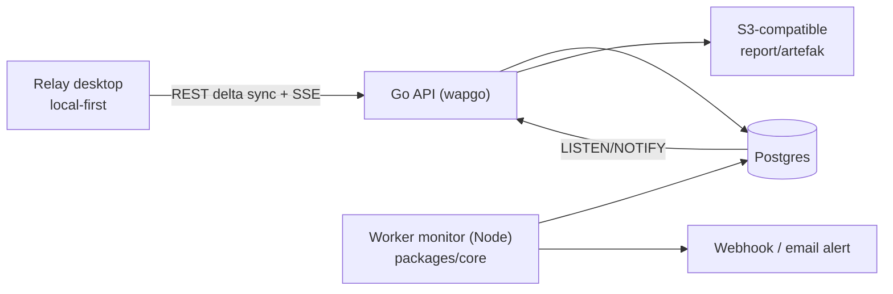

# Backend + Collaboration — Implementation Plan

Status: **draft disetujui, belum ada kode backend**. Dokumen ini adalah rencana eksekusi fase backend: cloud sync, team workspace, dan monitor. Referensi keputusan: `Relay/Backend plan (wapgo).md` dan `Relay/Keputusan desain.md` di vault Obsidian.

| Item | Nilai |
|---|---|
| Repo app | `relay` (Electron + React) |
| Repo backend | `github.com/abdullahPrasetio/wapgo` (scaffold Go, milik sendiri) |
| Target v1 backend | Team workspace (L2): sync multi-device + invite + role + presence, bukan CRDT |
| Infra | Postgres + S3-compatible; Redis opsional; tanpa Kafka/RabbitMQ |
| Engine | JS (`packages/core`) tetap sumber eksekusi; Go hanya API/orchestrator |

---

## 1. Keputusan arsitektur

| # | Keputusan | Alasan |
|---|---|---|
| D1 | Local-first dipertahankan; cloud adalah sinkronisasi, bukan sumber kebenaran tunggal | App tetap bisa dipakai offline |
| D2 | Sinkronisasi per **entity** (`rev`, `entity_changes.seq`), bukan satu dokumen workspace | Konflik bisa diselesaikan per request/folder |
| D3 | Tanpa CRDT/OT; konflik per field + banner “diubah anggota lain” | Biaya perawatan besar, nilai kecil untuk API client |
| D4 | Secret tidak disinkronkan di v1 (per-device); opsional E2E workspace key di fase 4 | Konsisten dengan ADR-3 dan export Git yang sudah ada |
| D5 | Auth memakai yang sudah ada di wapgo: JWT access 15 m + refresh rotasi dengan grace 120 dtk, bcrypt, Google OAuth | Refresh disimpan di Postgres, bukan Redis. Grace mencegah lockout saat respons refresh hilang di jaringan buruk |
| D6 | Monitor dijalankan worker Node berbasis `packages/core`, dikelola queue Postgres | Semantik proxy/TLS/cookie identik dengan app |
| D7 | Realtime: SSE + `LISTEN/NOTIFY` untuk sinyal perubahan; presence lewat tabel heartbeat | Tanpa Redis/WebSocket untuk v1 |
| D8 | Otorisasi di layer query (join `workspace_members`), bukan middleware role global | Mencegah IDOR antar workspace |
| D9 | Login **tidak wajib**; app selalu bisa dipakai lokal. Backend mati = mode offline, bukan logout | Server/DB down tidak boleh memblokir pekerjaan |
| D10 | Push bersifat idempoten lewat `opId` (dedupe di server) | Retry setelah timeout tidak menghasilkan konflik palsu |

### 1.1 Infra minimal (tanpa Redis)

Deployment v1 cukup **Go API + Postgres**; S3 hanya jika artefak monitor ingin disimpan di object storage (alternatif: disk lokal/volume). Tidak ada Redis, Kafka, RabbitMQ.

- `REDIS_URL` opsional: tanpa itu, rate limit berjalan in-memory per instance dan cache di-skip.
- `LISTEN/NOTIFY`, advisory lock, queue River, sesi, dan presence semuanya di Postgres.
- Konsekuensi: rate limit tidak akurat lintas instance. Selama v1 berjalan satu instance (atau limit login ditaruh di edge), ini aman.

### 1.2 Topologi repo

| Repo | Isi | Artefak rilis |
|---|---|---|
| `relay` (repo ini) | Electron + React, engine JS lokal, installer | Artifact/release 3 OS |
| `wapgo` | Scaffold Go (root + CLI + skeleton) | Tag release CLI |
| `relay-api` (**baru**) | Service Go: auth, workspace, sync, monitor worker | Image OCI + job `make migrate` |
| Kontrak | `relay-api/openapi.yaml` + fixture workspace JSON dari app | — |

Alasan dipisah: toolchain berbeda (Node vs Go), siklus rilis berbeda (installer vs image), CI berbeda (Playwright vs `go test`), dan repo backend bisa private tanpa mengunci app.

**Penting:** `wapgo new` menyalin `cli/generator/templates/skeleton`, bukan root repo. Perbaikan Fase 0 di root (migrasi, SSRF) **tidak** otomatis ikut ke proyek baru. Dua jalur yang sah:

1. Clone root `wapgo` pada commit yang sudah diperbaiki → repo `relay-api`, lalu trim `examples/`, `cli/`, `docs/` yang tidak dipakai.
2. Port perbaikan ke skeleton (langkah 0.7), lalu `wapgo new relay-api --module github.com/.../relay-api`.

Kontrak lintas repo:

- OpenAPI dihasilkan backend (`swag init`) dan dipakai app sebagai acuan; perubahan breaking menaikkan `/api/v1` → `/api/v2`.
- Bentuk entity workspace memakai JSON yang sudah ada; fixture hasil `gitWorkspace` export app disimpan di `relay-api/testdata/` dan dipakai test backend.
- Migrasi, auth, sync, dan monitor **hanya** ada di `relay-api`; `wapgo` hanya berisi perbaikan scaffold generik.

---

## 2. Arsitektur target



---

## 3. Skema data inti

```sql
create table users (
  id uuid primary key,
  email text not null unique,
  password_hash text,                 -- bcrypt; null untuk OAuth-only
  display_name text not null default '',
  created_at timestamptz not null default now()
);

create table sessions (
  id uuid primary key,
  user_id uuid not null references users(id) on delete cascade,
  device_label text not null default '',
  refresh_hash text not null unique,  -- sha256(refresh token)
  prev_hash text,                     -- grace: token sebelumnya
  prev_expires_at timestamptz,        -- grace berakhir
  expires_at timestamptz not null,
  revoked_at timestamptz,
  created_at timestamptz not null default now(),
  last_used_at timestamptz
);

create table workspaces (
  id uuid primary key,
  name text not null,
  owner_id uuid not null references users(id),
  created_at timestamptz not null default now(),
  deleted_at timestamptz
);

create table workspace_members (
  workspace_id uuid not null references workspaces(id) on delete cascade,
  user_id uuid not null references users(id) on delete cascade,
  role text not null check (role in ('owner','admin','editor','viewer')),
  invited_by uuid references users(id),
  created_at timestamptz not null default now(),
  primary key (workspace_id, user_id)
);

create table entities (
  workspace_id uuid not null references workspaces(id) on delete cascade,
  id text not null,                   -- id lokal dari app (ws_/col_/req_/env_)
  kind text not null check (kind in ('collection','folder','request','environment','globals')),
  parent_id text,
  order_key text,                     -- fractional index untuk reorder
  rev bigint not null default 1,
  payload jsonb not null,
  deleted_at timestamptz,
  updated_by uuid not null,
  updated_at timestamptz not null default now(),
  primary key (workspace_id, id)
);

create table entity_changes (
  seq bigint generated always as identity primary key,
  workspace_id uuid not null references workspaces(id) on delete cascade,
  entity_id text not null,
  rev bigint not null,
  deleted boolean not null
);
create index entity_changes_pull on entity_changes (workspace_id, seq);

-- Idempotensi push: retry dengan opId sama tidak diterapkan dua kali.
create table entity_ops (
  workspace_id uuid not null references workspaces(id) on delete cascade,
  op_id text not null,                -- uuid dari klien
  entity_id text not null,
  rev bigint not null,
  result jsonb not null,              -- {applied:true} / {conflict:true, server:{...}}
  created_at timestamptz not null default now(),
  primary key (workspace_id, op_id)
);

create table invites (
  id uuid primary key,
  workspace_id uuid not null references workspaces(id) on delete cascade,
  role text not null check (role in ('admin','editor','viewer')),
  token_hash text not null unique,
  created_by uuid not null references users(id),
  expires_at timestamptz not null,
  accepted_at timestamptz,
  accepted_by uuid references users(id)
);

create table presence (
  workspace_id uuid not null,
  user_id uuid not null,
  entity_id text,
  last_seen timestamptz not null,
  primary key (workspace_id, user_id)
);

create table monitors (
  id uuid primary key,
  workspace_id uuid not null references workspaces(id) on delete cascade,
  name text not null,
  request_id text not null,           -- entity request yang dijalankan
  cron text not null,                 -- mis. "*/5 * * * *"
  enabled boolean not null default true,
  alert_webhook text,
  alert_email text,
  next_run_at timestamptz,
  created_at timestamptz not null default now()
);

create table monitor_runs (
  id uuid primary key,
  monitor_id uuid not null references monitors(id) on delete cascade,
  started_at timestamptz not null,
  finished_at timestamptz,
  ok boolean,
  status_code int,
  duration_ms int,
  error text,
  assertion_failures int not null default 0,
  artifact_url text
);
create index monitor_runs_lookup on monitor_runs (monitor_id, started_at desc);

create table audit_events (
  id bigint generated always as identity primary key,
  workspace_id uuid not null,
  actor_id uuid not null,
  action text not null,
  target text,
  meta jsonb not null default '{}'::jsonb,
  created_at timestamptz not null default now()
);
```

Catatan: `entities.payload` memakai bentuk node yang sudah ada di app (`src/lib/factory.js`), sehingga sync tidak memerlukan format baru.

---

## 4. Kontrak API

Base path: `/api/v1`. Semua endpoint workspace wajib memvalidasi membership + role.

| Method | Path | Body / query | Response |
|---|---|---|---|
| POST | `/auth/login` | `{email, password, deviceLabel}` | `{accessToken, refreshToken, user}` |
| POST | `/auth/refresh` | `{refreshToken, deviceLabel}` | pair baru (rotasi). Token lama diterima sekali dalam grace 120 dtk dan mengembalikan pasangan yang sama; reuse setelah grace → 401 + revoke family |
| POST | `/auth/logout` | `{refreshToken}` | `204` |
| GET | `/auth/devices` | — | daftar sesi aktif |
| DELETE | `/auth/devices/{id}` | — | `204` (revoke) |
| POST | `/auth/oauth/google` | `{code, redirectUri, deviceLabel}` | pair token |
| GET | `/workspaces` | — | daftar workspace + role |
| POST | `/workspaces` | `{name}` | workspace baru |
| PATCH | `/workspaces/{id}` | `{name}` | workspace |
| DELETE | `/workspaces/{id}` | — | `204` (owner only) |
| GET | `/workspaces/{id}/members` | — | daftar anggota |
| POST | `/workspaces/{id}/invites` | `{role, expiresInHours}` | `{inviteUrl}` |
| POST | `/invites/{token}/accept` | — | `{workspace, role}` |
| PATCH | `/workspaces/{id}/members/{userId}` | `{role}` | anggota |
| DELETE | `/workspaces/{id}/members/{userId}` | — | `204` |
| GET | `/workspaces/{id}/changes` | `?since=<seq>&limit=500` | `{changes: [{id,kind,rev,deleted,payload,parentId,orderKey}], nextSeq, hasMore}` |
| POST | `/workspaces/{id}/changes` | `{changes: [{opId, id, kind, baseRev, payload, parentId, orderKey, deleted}]}` | `{results: [{opId, applied, conflict?, server?}], serverSeq}` |
| GET | `/workspaces/{id}/stream` | SSE; `Last-Event-ID` = seq | event `{seq}` per perubahan |
| POST | `/workspaces/{id}/presence` | `{entityId}` | `204` |
| GET | `/workspaces/{id}/audit` | `?before=` | daftar audit (admin+) |
| CRUD | `/workspaces/{id}/monitors` | monitor payload | monitor |
| GET | `/monitors/{id}/runs` | `?limit=50` | riwayat run |
| POST | `/workspaces/{id}/artifacts/presign` | `{name, contentType}` | `{uploadUrl, artifactUrl}` |

Semantik konflik `POST /changes`:

- `opId` disimpan di `entity_ops`. Jika `opId` sudah ada, server mengembalikan hasil tersimpan tanpa menerapkan ulang; ini membuat retry setelah timeout aman.
- `baseRev === entities.rev` → apply, `rev+1`, append `entity_changes`.
- `baseRev !== rev` → server mengembalikan `{id, server: {rev, payload}, conflict: true}`; client melakukan merge per field atau menampilkan dialog.
- `deleted: true` dengan `baseRev` cocok → tombstone.
- Semua dalam satu transaksi per batch (atau per entity dengan partial success yang eksplisit).

---

## 5. Perilaku saat backend tidak tersedia

Login hanya diperlukan untuk fitur cloud. Tanpa login, app tetap menjadi API client lokal penuh; server mati tidak boleh memblokir pekerjaan.

| Kejadian | Perilaku app | Data/token |
|---|---|---|
| Belum pernah login | Semua fitur lokal berjalan | File lokal |
| Server mati saat startup | Load lokal, banner “Offline”, tanpa modal blokir | File lokal |
| Edit saat offline | Simpan lokal, masukkan queue (`entity`, `baseRev`, `opId`) | Queue persisten |
| Access token kedaluwarsa saat offline | Tetap offline tanpa loop refresh; retry backoff 1 dtk → 60 dtk + jitter | Token tidak dihapus |
| Refresh gagal karena jaringan | Dianggap offline, **bukan** logout | Token dipertahankan |
| Refresh 401 `invalid_grant`/revoked | Minta login ulang; queue tetap | Data lokal utuh |
| Server kembali | Flush queue berurutan, lalu pull delta, selesaikan konflik | Queue kosong |
| Respons push hilang setelah server commit | Retry `opId` sama → hasil tersimpan, tidak dobel | — |
| Respons refresh hilang setelah rotasi | Token lama diterima dalam grace 120 dtk dan mengembalikan pasangan yang sama | Tidak logout |
| 403 akses workspace dicabut | Sync berhenti; lokal jadi read-only + banner; export tetap jalan | Data lokal tidak dihapus |
| 5xx | Retry backoff; tidak menandai gagal permanen | — |
| 4xx validasi | Tandai item gagal beserta alasan; data lokal tetap | — |
| Monitor | Tidak berjalan saat server mati (server-side); run tertinggal dieksekusi setelah hidup | — |

Aturan implementasi:

- Error jaringan **tidak boleh** menghapus token atau data lokal; hanya 401 `invalid_grant`/revoked yang memicu login ulang.
- Refresh **single-flight**: satu refresh berjalan, request lain menunggu, agar rotasi tidak balapan.
- Queue dipersist memakai atomic write yang sudah ada (`electron/store.js`).
- Indikator status: `Local only`, `Synced`, `Offline (N pending)`, `Conflict`, `Signed out`.

---

## 6. Langkah kerja per fase

Legenda: `[ ]` belum, `[x]` selesai, gate test ditulis di tiap langkah.

### Fase 0 — Perbaikan upstream wapgo (prasyarat)

- [x] **0.1** Implementasi runner migrasi nyata: `cmd/migrate` (golang-migrate) dengan SQL di-embed, advisory lock, dan target Makefile. *Selesai 2026-10-29; gate up/down lulus di Postgres 14.*
  - Test: `go run ./cmd/migrate up` menerapkan file di DB kosong; `down` mengembalikan; dijalankan dua kali tidak error.
- [x] **0.2** `AutoMigrate` hanya untuk dev: default config `false`, API menolak `DB_AUTO_MIGRATE=true` saat `APP_ENV=production`. *Selesai 2026-10-29; start dengan auto-migrate off tidak membuat tabel.*
  - Test: start dengan `DB_AUTO_MIGRATE=false` tidak membuat tabel; migrasi eksplisit yang membuat.
- [x] **0.3** SSRF: resolusi DNS divalidasi lalu IP yang sama di-dial langsung (anti DNS rebinding) + opsi `AllowPrivate` untuk self-host. *Selesai 2026-10-29; test loopback/mixed-IP/resolver-once lulus.*
  - Test: hostname yang resolve ke `127.0.0.1` ditolak; `AllowPrivate=true` mengizinkan; redirect ke IP privat ditolak.
- [x] **0.4** Redis opsional: cache + blacklist punya implementasi Redis dan in-memory; API berjalan dengan `REDIS_URL` kosong. *Selesai 2026-10-29; login/logout/refresh tetap jalan tanpa Redis (revocation instance-local). Sesi refresh di Postgres diimplementasikan di relay-api.*
  - Test: service start tanpa `REDIS_URL`; logout tetap merevoke token.
- [x] **0.5** Template worker scheduler di skeleton (`run-worker`/`build-worker`). *Selesai 2026-10-29, deviasi dari rencana: queue Postgres `FOR UPDATE SKIP LOCKED` + retry/backoff, bukan River, agar tanpa dependency baru.*
  - Test: worker mengambil job `SKIP LOCKED`, retry tercatat, graceful shutdown.
- [x] **0.6** Rate limiter bersama: `RATE_LIMIT_BACKEND=memory|redis`, RedisLimiter atomik, header `Retry-After`/`X-RateLimit-Remaining`, keterbatasan in-memory didokumentasikan. *Selesai 2026-10-29; test miniredis lulus.*
  - Test: dua instance berbagi kuota saat Redis aktif.
- [x] **0.7** Port runner migrasi + SSRF dialer ke `cli/generator/templates/skeleton` (termasuk Makefile, go.mod, `.env.example`), agar `wapgo new` mewarisi perbaikan tanpa copy manual. *Selesai 2026-10-29; proyek hasil generate lulus build/test dan migrate up/down di Postgres.*
  - Test: generate proyek baru di direktori sementara, `make migrate` berjalan, dan dial ke `127.0.0.1` diblokir secara default.

### Fase 1 — Auth + cloud sync per user (3–4 minggu)

- [x] **1.1** Buat repo `relay-api` sesuai topologi 1.2; `wapgo new` dengan semua add-on off (tanpa Kafka/RabbitMQ/Filebeat). *Selesai 2026-10-29: `github.com/abdullahPrasetio/relay-api` @ `ae219fc`.*
  - Test: `go test ./...` hijau; `/health` 200; Docker image jalan sebagai nonroot.
- [x] **1.2** Domain `workspace`, `member`, `entity` + repository; query sync pakai raw SQL dalam satu transaksi (advisory lock per workspace). *Selesai 2026-10-29; test integrasi Postgres lulus.*
  - Test: unit usecase (mock repo) + integration Postgres (testcontainers/compose) untuk insert/update/rev.
- [x] **1.3** Endpoint workspace CRUD + attach workspace lokal (id mapping). *Selesai 2026-10-30; e2e Electron: signup → attach → status `Synced`, backend menerima baseline collection+globals.*
  - Test: buat workspace → owner otomatis member role owner; IDOR: workspace orang lain → 404.
- [x] **1.4** Delta push/pull (`/changes`, `entity_ops` dedupe) + transaksi `entity_changes`, beserta HTTP handler dan otorisasi role. *Selesai 2026-10-29; e2e viewer/editor/konflik/dedupe lulus.*
  - Test: push batch campuran create/update/delete; pull cursor konsisten; `baseRev` salah → conflict; retry `opId` sama tidak menerapkan dua kali.
- [x] **1.5** Klien desktop: `cloudSync.js` (flatten/diff/apply), controller + queue persisten, tombol attach di WorkspaceSwitcher, indikator status. *Selesai 2026-10-30; retry masih manual (`nextSyncDelay` tersedia), baseline rev in-memory.*
  - Test: unit queue (offline → reconnect); server dimatikan setelah login → edit tetap tersimpan dan terkirim saat server hidup; e2e dua instance app dengan userData berbeda + satu server.
- [ ] **1.6** Auth klien: login browser PKCE loopback, token di `safeStorage`, refresh single-flight + grace, kelola perangkat.
  - Test: e2e login/logout; rotasi refresh; refresh saat jaringan putus tidak menghapus token; revoke device membuat request 401.
- [ ] **1.7** Migrasi data lokal → cloud (workspace attach) idempoten.
  - Test: attach dua kali tidak menduplikasi entity; payload round-trip sama dengan export Git.

Gate fase: `go test ./...`, integration Postgres, `npm test`, `npx playwright test`, e2e sync 2 instance.

### Fase 2 — Team workspace (3–4 minggu)

- [x] **2.1** Invite link (token hash, expiry 7 hari, single-use) + accept flow. *Selesai 2026-10-30; e2e: create → accept → 409 saat reuse.*
  - Test: token kadaluarsa/terpakai ditolak; role sesuai; audit tercatat.
- [x] **2.2** Matriks izin + test IDOR untuk setiap endpoint. *Backend selesai 2026-10-30: admin-only invite/audit, viewer tidak bisa push, non-member 404.*
  - Test: viewer tidak bisa PATCH entity, editor tidak bisa invite, admin tidak bisa hapus workspace.
- [x] **2.3** UI anggota: daftar anggota, ubah role, hapus anggota, invite link sekali-tampil. *Selesai 2026-10-30.*
  - Test: e2e invite → accept (instance kedua) → muncul di daftar.
- [x] **2.4** SSE stream (`/stream`) + presence heartbeat. *Selesai 2026-10-30: pg_notify setelah push, event `<300ms`; app Electron berlangganan (`/stream` 200) dan menulis presence tiap 30 dtk.*
  - Test: edit di instance A → instance B menerima event dan menarik delta < 2 dtk; presence hilang setelah TTL.
- [ ] **2.5** UI konflik: banner + dialog pilih local/server/patch manual.
  - Test: dua edit field sama → dialog muncul; pilih server menimpa local; audit mencatat.
- [x] **2.6** Audit log (admin+) + UI. *Selesai 2026-10-30: aksi workspace/member/invite, paginasi, modal Activity.*
  - Test: invite/role/delete tercatat dengan actor dan target.

Gate fase: seluruh matriks izin lulus, e2e invite + sync + presence, tidak ada data leak antar workspace (test dua workspace berbeda user).

### Fase 3 — Monitor terjadwal (2–3 minggu)

- [ ] **3.1** CRUD monitor + validasi cron + `next_run_at`.
  - Test: cron invalid ditolak; perhitungan `next_run_at` diuji.
- [ ] **3.2** Worker Node: ambil job dari Postgres (`FOR UPDATE SKIP LOCKED`), jalankan `packages/core`, tulis `monitor_runs`.
  - Test: job sukses/gagal/retry; timeout; graceful shutdown; dua worker tidak double-run.
- [ ] **3.3** Assertion hasil test script + klasifikasi ok/fail.
  - Test: collection dengan test gagal → run `ok=false`, `assertion_failures>0`.
- [ ] **3.4** Alert webhook + email (opsional), retry dengan backoff, dedupe.
  - Test: webhook 500 → retry; alert hanya sekali per transisi status.
- [ ] **3.5** UI monitor: daftar, toggle, riwayat run, grafik durasi sederhana.
  - Test: e2e start monitor interval 1 menit (dengan clock inject) → run muncul.

Gate fase: worker idempoten, alert tidak dobel, tidak ada SSRF ke network internal (kecuali `AllowPrivate`).

### Fase 4 — Opsional (3+ minggu)

- [ ] **4.1** E2E secret sharing: kunci publik per device (X25519), data key workspace dibungkus per anggota, rotasi saat anggota keluar.
  - Test: server tidak bisa dekripsi; anggota baru membuka secret setelah envelope dibagikan; anggota keluar kehilangan akses.
- [ ] **4.2** Komentar/activity feed per request (thread, mention).
- [ ] **4.3** (Evaluasi) live editing per field — hanya jika data menunjukkan kebutuhan.

---

## 7. Checklist status keseluruhan

### Sudah dikerjakan dan teruji (app, bukan backend)

- [x] Fase 0–6 roadmap app: network engine, auth, runtime sandbox, workflow, protokol, mock/docs/git workspace, signing pipeline.
- [x] Unit test: 613 lulus / 45 file (`npm test`, setelah Fase 1 client).
- [x] E2E: 19 lulus (`npx playwright test`), termasuk sync sesi, quit handshake, tema, environment menu.
- [x] Lint: 0 error; build produksi sukses.
- [x] CI GitHub Actions 3 OS (`.github/workflows/build.yml`) hijau; artifact mac/win/linux terunggah.
- [x] Tema System/Light/Dark + 8 aksen; Monaco mengikuti tema.
- [x] Header ringkas: satu pill environment + menu, 4 tombol ikon.
- [x] Perbaikan layout response pane (editor tidak kolaps) dan stacking dropdown header.
- [x] Dev crash `bufferutil` diperbaiki (`WS_NO_BUFFER_UTIL`/`WS_NO_UTF_8_VALIDATE`).
- [x] Evaluasi scaffold wapgo + rencana adaptasi (dokumen vault).

### Belum dikerjakan

- [x] Fase 0 (sisa): Redis opsional, scheduler, rate limit.
- [x] Fase 0.1–0.2 wapgo: runner migrasi SQL (`cmd/migrate`) + guard `AutoMigrate` (uji up/down Postgres 14).
- [x] Fase 0.3 wapgo: SSRF cek IP hasil DNS di dialer + `AllowPrivate`.
- [x] Fase 0.7 wapgo: perbaikan di-port ke skeleton; proyek hasil generate terverifikasi.
- [x] Fase 0.4–0.6 wapgo: Redis opsional, rate limiter memory/redis, worker Postgres di skeleton; generate+build+migrate terverifikasi.
- [x] Fase 1.1: repo `relay-api` dibuat dari scaffold (public, `main`).
- [x] Fase 1 server: auth foundation (sessions, refresh rotation+grace, devices) dan workspace API (CRUD, members, changes) teruji e2e dengan Postgres.
- [x] Fase 1 client: cloud client main-process (single-flight refresh, token aman), engine sync, UI login/attach/status/konflik; e2e Electron lulus terhadap relay-api nyata.
- [x] Fase 2 server: invite link + accept, audit log, SSE via `LISTEN/NOTIFY`, presence; live smoke lulus (invite, audit, SSE <300ms).
- [x] Fase 2 client: modal Members (role/remove/invite), modal Audit, SSE consumer + presence heartbeat di app; e2e Electron lulus.
- [x] Hardening backend: cap 200 change/batch, `cmd/prune` untuk `entity_ops` (+index), CI 4 job (build/vet/race, integrasi Postgres, gosec, lint), README proyek. *Selesai 2026-10-30.*
- [ ] Fase 1 (sisa): PKCE browser + UI kelola perangkat, auto-retry scheduler, baseline rev persisten, uji idempotensi attach.
- [ ] Fase 2: team workspace (invite, role, SSE, presence, konflik).
- [ ] Fase 3: monitor terjadwal.
- [ ] Fase 4: E2E secret sharing, komentar.
- [ ] Rilis v1.0 app: merge PR stack + signed release + auto-update.
- [ ] Hardening app Fase 8: token cache persisten, ekstraksi `packages/core` nyata, cookie jar per-run.
- [ ] Cleanup chunk lama `dist-electron/`.

---

## 8. Test matrix

| Lapisan | Perintah | Cakupan |
|---|---|---|
| Backend unit | `go test ./...` | usecase/handler/repo (mock) |
| Backend integrasi | `go test -tags=integration ./internal/integration/...` | Postgres (tanpa Redis) + Redis opsional via compose |
| Backend statis | `golangci-lint run`, `gosec -severity medium -confidence medium ./...` | lint + security |
| App unit | `npm test` | 568 test; tambah queue sync, backoff, single-flight refresh |
| App e2e | `npx playwright test` | 19 test; tambah sync 2 instance, invite, konflik, presence |
| Degraded mode | e2e dengan server dimatikan/dihidupkan | offline edit→reconnect, retry `opId`, refresh grace, 403 workspace dicabut |
| Build | `npm run dist` / `dist:win` / `dist:linux` | installer 3 OS |

Aturan: setiap langkah di atas wajib menambah test yang gagal sebelum implementasi dan lulus sesudahnya. Test wiring/echo mock tidak dihitung.

---

## 9. Definition of done per fase

**Fase 1:** dua instance app (user sama, device berbeda) berbagi workspace; edit di A muncul di B setelah reconnect; tidak ada duplikasi entity saat attach; token bisa direvoke; **server dimatikan setelah login → app tetap penuh, edit masuk queue, dan tersinkron saat server hidup tanpa konflik palsu**; refresh gagal jaringan tidak membuat logout.

**Fase 2:** user B menerima invite dan mengedit; user C (viewer) tidak bisa mengubah; perubahan A tampil di B < 2 dtk; konflik field sama memunculkan dialog; audit mencatat semua aksi sensitif; tidak ada kebocoran data antar workspace; workspace yang aksesnya dicabut menjadi read-only lokal tanpa menghapus data.

**Fase 3:** monitor berjalan sesuai cron, riwayat tersimpan, alert terkirim sekali per transisi, worker restart tidak menggandakan run.

---

## 10. Risiko

| Risiko | Mitigasi |
|---|---|
| Kompleksitas konflik melebihi perkiraan | Batasi ke konflik per field untuk entity request; sisanya tombstone + dialog |
| Kebocoran antar workspace (IDOR) | Test matriks izin per endpoint; query selalu join membership |
| SSRF monitor | Dial-time IP check + allowlist/allow-private eksplisit |
| Engine drift (Go vs JS) | Monitor memakai worker Node `packages/core`; conformance fixture bila kelak ada engine Go |
| Biaya infra | Postgres managed kecil + S3; Redis opsional |
| wapgo bug memblokir | Fase 0 diselesaikan lebih dulu, dengan test |

---

## 11. Cara mulai

```bash
# backend
git clone https://github.com/abdullahPrasetio/wapgo
cd wapgo && go run ./cmd/migrate up      # setelah Fase 0.1 selesai
wapgo new relay-api --module github.com/abdullahPrasetio/relay-api

# app
cd /Users/temancode/Project/learn/postman-rea
git checkout -b feat/backend-cloud-sync
```
