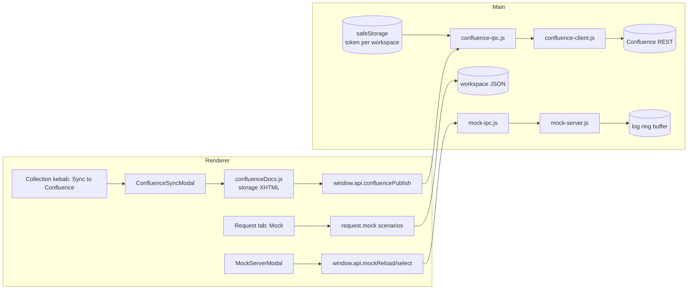

# Rencana: Confluence export + mock server dengan skenario

Status: **Confluence (M1–M3) dan mock scenarios (M4–M5) sudah diimplementasikan**
(2026-10-31). Confluence ada di branch `feat/confluence-sync`; mock ada di
`feat/mock-scenarios` yang di-stack di atas branch Confluence agar tidak ada
konflik schema/normalizer. Rilis tetap dipisah dan merge dilakukan berurutan.
Baseline: Relay local-first (Electron main + React, satu workspace JSON),
sudah punya mock server berbasis saved example dan export docs HTML statis.

Catatan implementasi mock: editor memakai textarea (bukan Monaco), regex
condition tetap ditunda, dan backup Postman menyimpan `_relayMock` hanya untuk
workspace backup (export Postman biasa tetap bersih).

## 1. Keputusan arsitektur

| Area | Keputusan | Alasan |
|---|---|---|
| Confluence | Renderer membuat **Confluence storage-format XHTML**; main process yang bicara ke REST Confluence | CSP renderer memblokir network eksternal; kredensial tidak boleh masuk renderer |
| Kredensial Confluence | Main-owned, per workspace, dienkripsi `safeStorage`; renderer hanya melihat `hasToken` | Workspace JSON ikut cloud/backup/Git; token tidak boleh ikut |
| Halaman | Update by `pageId`; **create** jika `pageId` kosong (butuh space key) | Wapify hanya update dan memaksa user mencari page ID manual |
| Konflik versi | GET versi → PUT `versi+1`; 409 dikembalikan ke UI, user memilih overwrite | Tidak menimpa edit orang lain secara diam-diam |
| Mock | Perluas mock server yang ada; skenario disimpan **per request** (`request.mock`) | Route sudah berasal dari request; tidak perlu entitas endpoint kedua |
| Evaluasi mock | Auto (kondisi) / manual (skenario terpilih); deterministic route precedence | Wapify punya urutan tidak deterministik dan bug manual lintas endpoint |
| Template mock | Hanya `{{request.query/header/body/path...}}`; **tidak** meresolve secret/workspace variable | Mock bisa diakses proses lain; jangan bocorkan secret |
| Transport mock | Tetap `127.0.0.1`, tanpa auth, CORS `*` | Sama seperti perilaku sekarang; aman untuk alat lokal |

Yang **tidak** diport dari Wapify:

- Mock server Go/Fiber, tabel `mock_endpoints/mock_scenarios`, auth JWT.
- Bug: delete standalone rusak, tanpa ownership check, skenario tanpa kondisi
  tidak pernah match di auto, precedence route tidak jelas, `active_scenario_id`
  bisa menunjuk skenario endpoint lain, 404 tidak tercatat.
- Attachment Confluence (tidak ada gambar di docs Relay) dan 4 mode
  OpenAPI/Swagger — di luar lingkup awal.
- Chaos mode/error injection, binary mock response, regex condition (ReDoS)
  untuk v1.

## 2. Alur target



## 3. Confluence

### 3.1 UX

1. **Workspace → Confluence settings** (dari `WorkspaceSwitcher`):
   base URL, auth method (`Cloud` = email + API token, `Data Center` = PAT),
   email, token (write-only), allow self-signed TLS (default off, warning),
   tombol **Test connection**.
2. **Collection kebab → Sync to Confluence**:
   - belum dikonfigurasi → arahkan ke settings;
   - sudah punya `confluencePageId` → tampilkan link dan status sync, opsi
     include examples, tombol **Update page**;
   - belum punya page ID → mode **Update-only** tetap default: user paste
     page ID halaman existing. **Create page** hanya aktif jika user mengisi
     space key + parent page ID secara eksplisit;
   - field **Page title** per collection (default nama collection), bisa
     diubah; dicek unik dalam space sebelum publish;
   - hasil sukses menulis `confluencePageId`, `confluencePageUrl`,
     `confluenceSyncedAt` ke collection (non-secret) dan menampilkan link.
3. **Conflict 409**: dialog “Page changed since last sync” dengan pilihan
   Cancel / Overwrite (retry dengan versi terbaru). Tidak retry otomatis.
4. Tidak ada sync otomatis/background di v1; hanya aksi eksplisit.

### 3.2 Data dan keamanan

Main-owned store (`electron/store.js`):

```js
confluenceByWorkspace: {
  [workspaceId]: {
    baseUrl: 'https://org.atlassian.net/wiki',
    authMethod: 'cloud',        // 'cloud' | 'pat'
    email: 'dev@org.com',
    allowInsecureTls: false,
    tokenEnc: '<safeStorage base64>',
    updatedAt: '...'
  }
}
```

- `getAll()` tidak boleh mengembalikan `tokenEnc` ke renderer. Handler
  `confluence:get-config` mengembalikan `hasToken` saja.
- `setAll()` mempertahankan `confluenceByWorkspace` seperti `cookieJar`/`network`.
- `safeStorage` tidak tersedia → tolak simpan token, jangan plaintext.
- Collection (workspace JSON, boleh ikut cloud/Git). Semua field tujuan
  halaman ada di collection, bukan workspace:

```js
confluencePageId: '',
confluencePageUrl: '',
confluenceTitle: '',          // kosong = pakai nama collection
confluenceSpaceKey: '',       // wajib untuk create
confluenceParentPageId: '',   // wajib untuk create
confluenceSyncedAt: null,
confluenceVersion: null       // versi terakhir yang kita tulis (informasi)
```

Normalisasi yang **wajib** disentuh agar field tidak hilang:
`newCollection` (`src/lib/factory.js`), `normalizeCollection`
(`src/lib/collectionTree.js`), `collectionFile` (`src/lib/gitWorkspace.js`),
backup metadata (`src/lib/postmanFormat.js`), dan test cloud payload.
`SCHEMA_VERSION` naik ke 3 (main otomatis membuat backup sebelum migrasi).

### 3.2.1 Siklus kredensial local-first

Local-first berarti **tidak ada server Relay di tengah**. Aplikasi desktop
memanggil Confluence langsung; token hanya berada di mesin user.

| Data | Lokasi | Ikut cloud/Git/backup? |
|---|---|---|
| Token/PAT | main store, `safeStorage` ciphertext | Tidak |
| Base URL, email, auth method | main store (non-secret) | Tidak |
| Page ID/URL, title, space, parent, timestamp | workspace JSON | Ya |

Aturan implementasi:

- Renderer tidak pernah menerima token. Setelah disimpan, field hanya
  menampilkan `•••• saved` + tombol Clear; blank = tidak berubah.
- Semua operasi (`test`, `publish`) memakai `workspaceId`, bukan token dari
  renderer. Payload publish tidak boleh memuat base URL/token.
- Token **diikat ke origin + auth mode + email**. Jika user mengubah host,
  scheme, port, auth method, atau email tanpa mengirim token baru, token lama
  dihapus dan user harus memasukkan ulang. Ini mencegah token terkirim ke host
  lain lewat perubahan konfigurasi.
- `safeStorage` tidak tersedia (mis. Linux `basic_text`) → simpan ditolak;
  tidak ada fallback plaintext.
- Keychain reset / pindah mesin → decrypt gagal → UI minta token ulang. Page
  ID tetap ada sehingga sync berikutnya tetap update halaman yang sama.
- Tidak ada recovery token dari cloud. Jika user kehilangan akses Keychain,
  buat token baru di Atlassian.

Alur create/update:

| Kondisi | Aksi |
|---|---|
| Belum ada `pageId`, space + parent diisi, title unik | `POST /rest/api/content` dengan `ancestors`; simpan page ID/URL/title |
| Sudah ada `pageId` | `GET` versi → `PUT` versi+1 |
| Tidak punya izin create / ragu root | user paste page ID halaman existing → mode update |
| Title sudah dipakai page lain di space | `title_conflict`; user pilih link page existing / ubah title / batal |
| 409 saat update | dialog overwrite eksplisit, bukan retry otomatis |
| Token hilang/tidak valid | error jelas; arahkan ke settings, jangan hapus page metadata |

Team sharing: setiap anggota memakai token Atlassian masing-masing; tidak ada
token bersama yang disebar. Jika nanti dibutuhkan service account/backend
broker, itu keputusan arsitektur berbeda (bukan local-first murni).

### 3.2.2 Root halaman dan keunikan title

Confluence tidak punya folder bebas. Page tanpa `ancestors` akan dibuat di
bawah **space homepage** (top-level). Karena itu create tidak boleh implicit:

- **Update-only tidak butuh space/parent.** Cukup `pageId`; update halaman
  existing tetap bisa diexport. Ini jalur default.
- **Create selalu butuh space.** REST Confluence tidak bisa membuat page tanpa
  space tujuan (`space.key` di v1, `spaceId` di v2). Tanpa spaceKey, create
  memang tidak mungkin — bukan karena aplikasi membatasi.
- Parent sebenarnya **opsional di API**, tetapi aplikasi mewajibkannya agar
  page tidak otomatis jatuh ke root space. Tidak ada create tanpa parent di
  v1.
- Alternatif tanpa mengisi space/parent: buat page dulu di Confluence UI
  (pilih lokasi di sana), lalu paste page ID-nya ke collection → mode update.
- Opsi masa depan: paste **anchor page** (page existing); aplikasi mengambil
  `space.key` dan parent/anchor dari page itu untuk create sibling. Tetap
  butuh satu page acuan, jadi bukan create “buta”.
- **Create hanya aktif** jika `confluenceSpaceKey` dan
  `confluenceParentPageId` diisi (user membuat container page dulu di
  Confluence, misalnya “API Docs”, lalu paste ID/URL-nya). Tidak ada opsi
  “create di root space” di v1.
- Parent divalidasi sebelum POST:
  `GET /rest/api/content/{parentId}?expand=space,version`; harus
  `type:'page'` dan `space.key` sama dengan space tujuan. Gagal →
  `parent_invalid`, tidak ada request create.
- `POST` selalu mengirim `ancestors:[{id: parentPageId}]`, jadi halaman tidak
  bisa “nyasar” ke tempat lain.

Title:

- Title efektif = `confluenceTitle` (jika diisi) atau nama collection.
- Confluence umumnya menolak title duplikat dalam satu space. Jangan
  mengandalkan error 400; lakukan preflight:
  `GET /rest/api/content?spaceKey=<space>&title=<title>&expand=version&limit=1`.
- Jika hasilnya ada dan `id != pageId` target → `title_conflict` dengan
  `existingId`/URL. UI memberi pilihan: **Link/update page existing**,
  **Ubah title**, atau **Batal**. Tidak menimpa page yang tidak dikenal.
- Update yang mengubah title juga menjalani preflight yang sama.
- Dua collection di workspace yang sama tidak boleh memakai `pageId` yang
  sama; validasi sebelum publish dan tampilkan error jelas.
- Setelah create, simpan `pageId`, URL, title, space, parent, dan versi.
  Rename collection tidak otomatis mengganti title; user mengubah field title
  lalu sync (dengan preflight).
- Tidak ada auto-suffix di v1. Suffix seperti `— Relay docs` bisa menjadi
  opsi nanti jika banyak benturan dengan halaman manusia.

### 3.3 Base URL, auth, transport

- Normalisasi: trim, buang trailing `/`, tolak scheme selain `http/https`.
- API root:
  - path sudah berakhir `/rest/api` → pakai;
  - berakhir `/wiki` → tambah `/rest/api`;
  - host `*.atlassian.net` tanpa `/wiki` → tambah `/wiki/rest/api`;
  - lainnya → tambah `/rest/api`.
- Auth:
  - `cloud`: `Basic base64(email + ':' + apiToken)`;
  - `pat`: `Bearer <pat>`;
  - token kosong → error sebelum request.
- Transport memakai `sendRequest` + `createSendContext`
  (`packages/core/src/network-runtime.js`) agar proxy/TLS settings app
  dihormati, dengan `useCookieJar: false`, `followRedirects: false`,
  timeout 15 dtk. **Redirect 3xx = error** (“SSO/URL salah”) supaya
  `Authorization` tidak ikut ke host lain.
- `allowInsecureTls` hanya mengubah `settings.verifyTls` untuk request
  Confluence, bukan global.
- Tidak ada log token/body halaman; error hanya status + pesan Confluence.

### 3.4 Storage-format generator

Modul baru `src/lib/confluenceDocs.js` (pure, unit-testable):

```js
collectionToConfluenceStorage(collection, {
  includeExamples = true,
  generatedAt = null,
}): string
```

- Escape XML untuk text/attribute: `& < > " '`; buang karakter kontrol XML.
- Code macro memakai CDATA; `]]>` dipecah menjadi `]]]]><![CDATA[>`.
- Struktur: `h1` + deskripsi; TOC macro (`maxLevel=3`); folder `h2`;
  request `h2` (method berwarna + nama); URL `code`; deskripsi; tabel
  params/headers; body (`code` macro, mode raw/json/form/graphql); tabel
  collection variables dengan `type:'secret'` → `(secret)`; examples
  (status + body code) bila `includeExamples`.
- Auth hanya scheme (`Auth: bearer`), tidak pernah nilai token.
- Tidak ada resolusi variable; placeholder `{{...}}` dibiarkan apa adanya.
- Tidak ada attachment/gambar; footer “Generated by Relay” opsional.

### 3.5 Publish: kontrak dan algoritma

IPC (payload tidak pernah berisi token):

```js
window.api.confluenceGetConfig(workspaceId)
window.api.confluenceSetConfig({ workspaceId, baseUrl, authMethod, email,
  spaceKey, parentPageId, allowInsecureTls, token?, clearToken? })
window.api.confluenceTest(workspaceId)
window.api.confluencePublish({
  workspaceId, collectionId, pageId: string | '', title, content,
  spaceKey, parentPageId, force?: boolean,
})
```

`confluencePublish` di main:

1. Validasi input: `title` non-empty setelah trim; `pageId`/`spaceKey`/
   `parentPageId` hanya string; tolak URL/ID aneh. Baca config + decrypt
   token.
2. **Cek pageId ganda**: pastikan tidak ada collection lain di workspace yang
   memakai pageId sama; jika ada → `page_in_use` tanpa request jaringan.
3. `pageId` ada:
   - `GET /rest/api/content/{id}?expand=version,space`; 200 → versi `n`,
     title/space saat ini;
   - jika `spaceKey` diisi dan tidak sama dengan `space.key` halaman →
     `space_mismatch` (jangan edit halaman di space lain);
   - jika title berubah → preflight title (langkah 4);
   - `PUT /rest/api/content/{id}` body
     `{id,type:'page',title,body:{storage:{value,representation:'storage'}},version:{number:n+1}}`;
   - 409 → `{ok:false, code:'conflict', currentVersion}` (UI tanya overwrite);
   - 404 → `{ok:false, code:'page_not_found'}`.
4. **Preflight title** (create atau title berubah):
   `GET /rest/api/content?spaceKey=<space>&title=<title>&expand=version&limit=1`;
   jika ada hasil dengan `id != pageId` → `{ok:false, code:'title_conflict',
   existingId, existingUrl}`. UI: link/update existing, ubah title, atau batal.
   Tidak ada auto-suffix dan tidak ada overwrite page asing.
5. `pageId` kosong:
   - wajib `spaceKey` + `parentPageId`; jika tidak → `parent_required`;
   - `GET /rest/api/content/{parentId}?expand=space,version`; harus
     `type:'page'` dan `space.key` sama → jika gagal `parent_invalid`;
   - `POST /rest/api/content` body
     `{type:'page',title,space:{key:spaceKey},ancestors:[{id:parentPageId}],body:{storage:...}}`;
   - 400 duplicate title → `code:'title_exists'` (fallback bila preflight
     kalah balapan) + saran isi page ID.
6. Sukses → `{ok:true, pageId, version, url, created, title, spaceKey,
   parentPageId}`.
   URL dari `_links.base + _links.webui`; fallback
   `<base>/pages/viewpage.action?pageId=<id>`.
7. `confluenceTest` → `GET /rest/api/user/current`, kembalikan display name;
   HTML response (SSO) dideteksi dan dilaporkan sebagai error.

### 3.6 File yang disentuh

| File | Perubahan |
|---|---|
| `src/lib/confluenceDocs.js` (baru) | storage XHTML + escaping/CDATA |
| `electron/confluence-client.js` (baru) | API root, auth, GET/POST/PUT, test, error mapping |
| `electron/confluence-ipc.js` (baru) | config (encrypt/sanitize), test, publish + conflict |
| `electron/main.js` | daftarkan IPC, `shell.openExternal`, sanitasi `store:get` agar `confluenceByWorkspace.tokenEnc` tidak pernah ke renderer |
| `electron/preload.cjs` | 4 method bridge |
| `electron/store.js` | `confluenceByWorkspace` di EMPTY, getter/setter, preserve |
| `shared/schema.js` | `SCHEMA_VERSION = 3` |
| `src/lib/factory.js` | default field collection |
| `src/lib/collectionTree.js` | `normalizeCollection` mempertahankan page metadata |
| `src/lib/gitWorkspace.js` | `collectionFile` memuat metadata Confluence |
| `src/lib/postmanFormat.js` | backup menyimpan `_relayConfluence`; export biasa tidak |
| `src/components/ConfluenceSettingsModal.jsx` (baru) | config + test |
| `src/components/ConfluenceSyncModal.jsx` (baru) | create/update/conflict/link |
| `src/components/WorkspaceSwitcher.jsx` | menu settings |
| `src/components/Sidebar.jsx` | kebab “Sync to Confluence” |
| `src/components/App.jsx` | state modal + patch collection |
| `src/styles.css` | style modal/section (additive) |

### 3.7 Test dan acceptance

Unit:
- `confluenceDocs`: escaping `<>&"'`, CDATA `]]>`, nested folder, semua body
  mode, examples on/off, secret tidak pernah muncul, collection kosong.
- `confluenceClient`: API root derivation (Cloud/DC/`/wiki`), auth header,
  timeout, redirect ditolak, HTML SSO, 409/404/400 mapping, create body,
  update version+1, URL extraction, **parent validation**, **title preflight
  conflict**, **space mismatch**, **duplicate pageId**.
- normalisasi: page metadata (termasuk title/space/parent) bertahan lewat
  `normalizeCollection` → Git export → backup round-trip; cloud payload
  memuatnya; token tidak ada di workspace JSON.

E2E opt-in `RELAY_CONFLUENCE_E2E=1` dengan fake Confluence HTTP server:
- isi settings via UI, test connection;
- update-only: paste page ID → PUT versi 2;
- create mode tanpa parent → tombol/aksi ditolak, tidak ada POST;
- create dengan parent → POST memuat `ancestors:[parent]`, page ID tersimpan;
- title sudah dipakai page lain → dialog `title_conflict`, tidak overwrite;
- fake server balas 409 → dialog conflict muncul, overwrite mengirim versi
  terbaru;
- data file tidak memuat token plaintext.

Acceptance:
- user bisa update page yang sudah ada tanpa mengatur root;
- create hanya terjadi di bawah parent yang eksplisit dan tervalidasi;
- title duplikat tidak pernah membuat page baru/menimpa page asing;
- konflik tidak pernah ditimpa diam-diam;
- token tidak pernah dikirim ke renderer atau tersimpan plaintext;
- `npm test`, lint, build, e2e Confluence hijau.

## 4. Mock server: skenario

### 4.1 Model data (per request)

`newRequest()` mendapat default:

```js
mock: {
  enabled: true,                 // ikut diekspos di mock server
  mode: 'auto',                  // 'auto' | 'manual'
  activeScenarioId: null,
  scenarios: [],                 // urutan array = prioritas
}
```

Skenario:

```js
{
  id: 'scn_...',
  name: 'Success',
  enabled: true,
  status: 200,
  statusText: 'OK',
  headers: [{ key, value, enabled }],
  contentType: 'application/json',
  body: '{"ok":true}',
  delayMs: 0,
  isDefault: false,
  conditions: [
    { source: 'query', key: 'state', operator: 'equals', value: 'ok' }
  ]
}
```

`normalizeRequest` memanggil `normalizeMockConfig` dari modul shared baru
`shared/mockScenarios.js`, sehingga data lama (tanpa `mock`) tetap berjalan
dan field baru selalu ada. Array scenarios dipertahankan urutannya; UI
menyediakan naik/turun (tanpa dependency dnd baru).

### 4.2 Semantik

| Aspek | Aturan |
|---|---|
| Route | method exact + path; `:param` dan `{param}` sama-sama didukung |
| Precedence | path tanpa param > literal lebih banyak > segmen lebih banyak > urutan request |
| Duplikat | method+path identik: route pertama menang; UI memberi warning |
| Auto | skenario enabled pertama yang **semua** kondisinya match |
| Kondisi kosong | tidak pernah match di auto; hanya bisa default/manual |
| Default | skenario enabled pertama `isDefault` |
| Manual | `activeScenarioId` harus milik route; jika tidak valid → default → example |
| Fallback | skenario terpilih → default → example terbaru → 501 |
| Conditions | AND; source `query/header/body/path`; key body = dot path |
| Operator v1 | `equals`, `not_equals`, `contains`, `not_contains`, `exists`, `not_exists`, `gt`, `lt` (numerik bila kedua sisi angka, selain itu string) |
| Regex | ditunda (risiko ReDoS); tidak diekspos di v1 |
| Template | `{{request.query.x}}`, `{{request.header.x}}`, `{{request.body.a.b}}`, `{{request.path.id}}`; missing → `''` |
| Delay | `scenario.delayMs` > 0 menggantikan delay server; clamp 0–10.000 ms |
| Headers | scenario headers, buang `content-length`, lalu CORS permissive |
| Status | clamp 100–599; body UTF-8; cap 5 MB |
| Log | semua respons (termasuk 404), ring 200, tambah `scenarioId`, `scenarioName`, `matched` |

Catatan keamanan:
- Body request dibaca maksimal 1 MB dan hanya jika ada kondisi body/template
  body; JSON parse dibungkus try/catch; body non-JSON tidak match.
- Tidak ada resolusi variable/secret workspace di body mock.
- Bind tetap `127.0.0.1`; tidak ada opsi LAN di v1.

### 4.3 Runtime dan IPC

`electron/mock-server.js`:

- `startMockServer({ collections, port, delayMs })` membangun state mutable:
  `{ routes, logs, setRoutes(collections), selectScenario(requestId, id), status() }`.
- Route menyimpan `{ requestId, method, path, paramNames, matcher, mock }`;
  evaluasi memakai fungsi murni dari `shared/mockScenarios.js`.
- `setRoutes` menukar konfigurasi tanpa menutup listener/port; log tetap.
- `selectScenario` hanya override runtime (untuk demo); konfigurasi manual
  yang persisten tetap di `request.mock`.

`electron/mock-ipc.js`:

- `mock:start` seperti sekarang, route metadata diperkaya.
- `mock:reload({ collections })` — renderer mengirim snapshot workspace aktif
  (menghindari race debounce save), server tetap hidup.
- `mock:select({ requestId, scenarioId | null })` — override runtime; request id
  menghindari ambiguitas route duplikat.
- `mock:status` mengembalikan route + scenario + log; `mock:stop` tetap.

UI memanggil `mock:reload` setelah tombol **Reload routes** di modal, bukan
setiap keystroke. Dropdown skenario memanggil `mock:select` untuk pergantian
instan; mengubah mode/active scenario yang persisten dilakukan di tab Mock
lalu Reload.

### 4.4 UI

- `RequestPanel` dapat tab baru **Mock** (`MockScenariosPanel.jsx`):
  toggle “Expose in mock server”, mode Auto/Manual, daftar skenario
  (tambah/hapus/naik/turun/default), editor respons (status, headers via
  `KeyValueEditor`, body `CodeEditor`, content type, delay), dan builder
  kondisi (source/operator/key/value). Validasi inline; tidak ada regex.
- `MockServerModal`:
  - route list menampilkan `METHOD path`, jumlah skenario, mode + skenario
    aktif;
  - tombol **Reload routes**;
  - log table menambah kolom Scenario dan menandai 404/unmatched;
  - tetap polling 1 dtk (pola sekarang).
- Tidak perlu modal editor terpisah; tab Mock adalah sumber kebenaran.

### 4.5 File yang disentuh

| File | Perubahan |
|---|---|
| `shared/mockScenarios.js` (baru) | normalisasi, compile/match route + param, conditions, selection, template |
| `src/lib/factory.js` | `newRequest().mock` default |
| `src/lib/factory.js` / `normalizeRequest` | panggil `normalizeMockConfig` |
| `electron/mock-server.js` | route precedence, param capture, body read, scenario selection, template, log metadata, mutable state |
| `electron/mock-ipc.js` | reload/select, status metadata |
| `electron/preload.cjs` | `mockReload`, `mockSelect` |
| `src/components/RequestPanel.jsx` | tab Mock + badge |
| `src/components/MockScenariosPanel.jsx` (baru) | editor skenario |
| `src/components/MockServerModal.jsx` | route/scenario/log/reload |
| `src/styles.css` | style skenario/kondisi (additive) |
| `src/lib/postmanFormat.js` | backup menyimpan `_relayMock`; export Postman biasa tidak |
| `src/lib/gitWorkspace.js` | request sudah diexport utuh; tambah test |
| `src/lib/cloudSync.js` | payload request sudah utuh; tambah test |

### 4.6 Test dan acceptance

Unit (`test/unit/mockScenarios.test.js`, extend `mockServer.test.js`):
- normalisasi data lama/baru; scenario id unik; urutan stabil.
- route precedence (`/users/me` vs `/users/:id`), param capture, trailing
  slash, `{param}` dan `:param`.
- kondisi: tiap operator, header case-insensitive, body dot path, query,
  path param, AND, invalid JSON, body > 1 MB.
- selection: auto match, kondisi kosong, default, manual valid/invalid,
  fallback example, route tanpa example → 501.
- template substitution dan missing values.
- runtime: reload tanpa ganti port, select scenario, log metadata, delay clamp.
- persistence: `mock` bertahan `normalizeCollection`/`normalizeRequest`, Git
  export/import, backup round-trip; cloud flatten payload.

E2E `e2e/mockScenarios.spec.js`:
- seed workspace dengan request `/orders/:id` dan 3 skenario
  (success query `state=ok`, 404 header `x-fail`, default);
- buka Mock modal, start; fetch dari test process:
  `GET /orders/42?state=ok` → success + template `42`;
  `GET /orders/42` tanpa kondisi → default;
  manual select 404 → status/body berubah;
  reload setelah edit default → respons baru;
- log memuat scenario name; stop menutup port.

Acceptance:
- perilaku lama (tanpa `mock.scenarios`) tetap persis: example terbaru;
- skenario auto/manual deterministik dan bisa diganti tanpa restart;
- tidak ada secret workspace di respons mock;
- data bertahan reload, Git, backup, cloud;
- test/lint/build/e2e hijau.

## 5. Tahapan

| Milestone | Isi | Estimasi |
|---|---|---|
| M1 | Shared schema + normalisasi (`SCHEMA_VERSION=3`), `confluenceDocs` + test | 1–2 hari |
| M2 | Confluence client/IPC/store + settings modal + test connection | 2 hari |
| M3 | Sync modal update + create opt-in (parent wajib) + title preflight + conflict + link + e2e fake server | 3 hari |
| M4 | `shared/mockScenarios` + engine + IPC + unit test | 3 hari |
| M5 | Tab Mock + MockServerModal + e2e + Git/backup/cloud round-trip | 3–4 hari |

Total ±11–14 hari kerja; M1–M3 dan M4–M5 tidak saling bergantung sehingga bisa
diparalelkan setelah kesepakatan model data.

## 6. Risiko

| Risiko | Mitigasi |
|---|---|
| Token Confluence bocor lewat renderer/redirect | token hanya di main; sanitized config; redirect 3xx ditolak |
| Cloud vs Data Center beda base URL | derivasi `/wiki` + test connection; fake server untuk kedua bentuk |
| Konflik halaman menimpa edit orang | 409 → dialog overwrite eksplisit; tidak auto-retry |
| Create nyasar ke root space | create hanya dengan parent eksplisit + validasi space/type |
| Title duplikat di space | preflight title + `title_conflict`; tidak auto-suffix/overwrite |
| Field baru hilang saat normalisasi/export | update factory + normalizer + Git/backup + test round-trip |
| Route mock bertabrakan | precedence tetap + warning duplikat di UI |
| Body mock besar/ReDoS | cap 1 MB; regex tidak ada di v1 |
| Mock membocorkan secret | template hanya request data; tidak resolve variable |
| Perubahan skema merusak data lama | default `enabled:true`, fallback example; backup otomatis |

## 7. Non-goals v1

- Confluence: attachment/gambar, OpenAPI/Swagger mode, sync otomatis,
  multi-page per folder.
- Mock: binary/file response, chaos/error-rate injection, regex condition,
  SSE/streaming/WebSocket, bind ke LAN, proxy upstream.
- Perubahan pada export docs HTML yang sudah ada (kecuali bug yang ditemukan).

## 8. Keputusan yang perlu dikonfirmasi

1. Confluence: update-only default + create opt-in dengan parent wajib?
   Rekomendasi: ya, karena root space tidak deterministic.
2. Kredensial Confluence per workspace atau satu koneksi global? Rekomendasi:
   per workspace (main-owned, encrypted).
3. Title: field per collection + preflight, tanpa auto-suffix? Rekomendasi:
   ya; suffix bisa ditambah nanti.
4. Mock skenario: per request (rekomendasi) atau entitas endpoint terpisah?
5. Regex condition: tunda (rekomendasi) atau perlu di v1?
6. Mock response binary/file: tunda (rekomendasi) atau perlu?
