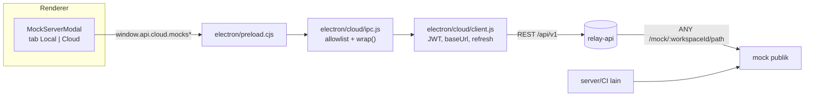

# Rencana: integrasi mock server relay-api ke Relay client

Status: **diimplementasikan (2026-11-10)**. Tab **Local** tetap memakai
`electron/mock-server.js`; tab **Cloud** memakai mock server relay-api lewat
main process (`electron/cloud/client.js` + IPC + preload), sehingga mock bisa
dipakai proses/mesin lain — bukan hanya `127.0.0.1` milik aplikasi.

| Item | Nilai |
|---|---|
| Repo app | `github.com/abdullahPrasetio/relay` (Electron + React + Vite) |
| Repo backend | `github.com/abdullahPrasetio/relay-api` (Go, Fiber) |
| Panel sekarang | `src/components/MockServerModal.jsx` (253 baris) + `electron/mock-server.js` (379 baris) |
| Sifat panel sekarang | **lokal**: route dibangun dari saved example, listen `127.0.0.1`, log in-memory |
| Prasyarat | mock server relay-api sudah di branch (migrasi `000010`–`000012`) dan DB sudah dimigrasi |

---

## 1. Keputusan arsitektur

| # | Keputusan | Alasan |
|---|---|---|
| D1 | Dua mode jelas di panel yang sama: **Local** (existing, offline) dan **Cloud** (relay-api) | Local tetap jalan tanpa internet; Cloud yang menjawab kebutuhan "diakses server lain" |
| D2 | Cloud mocks **tidak** dimirror ke workspace JSON lokal | Server adalah sumber kebenaran; mirror membuat dua state yang harus direkonsiliasi untuk data yang justru hidup di server |
| D3 | `request.mock` (mock lokal per request) **tidak** diubah dan tidak dimigrasi | Menghindari migrasi data user tanpa alasan; mode Local tetap seperti sekarang |
| D4 | Semua HTTP ke relay-api lewat **main process** (`electron/cloud/client.js`) | Konsisten dengan Confluence/cloud sync: CSP renderer memblokir network eksternal dan token tidak boleh masuk renderer |
| D5 | URL publik (`…/mock/<workspaceId>/<path>`) diperlakukan sebagai **capability**, ditampilkan dengan peringatan | Backend memang belum punya token per-workspace; UI harus jujur soal ini, bukan menyembunyikannya |
| D6 | Generate dari collection bersifat **idempoten di UI**: hasil `{created, skipped}` ditampilkan apa adanya | Server sudah menolak duplikat; UI tidak boleh menebak atau menyembunyikan `skipped` |
| D7 | Tidak ada polling status server; data diambil saat tab aktif + tombol refresh + setelah mutasi | Menghindari beban seperti `mock:status` lokal yang sekarang polling 1 detik |

---

## 2. Alur data



---

## 3. Kontrak API ↔ UI

Semua endpoint butuh Bearer (main process yang memegang token). Role: viewer
baca, editor tulis.

| Aksi UI | Endpoint | Catatan untuk UI |
|---|---|---|
| Buka tab Cloud | `GET /workspaces/:id/mocks` | respons `{mockBaseUrl, endpoints[]}`; tiap endpoint punya `url` siap copy |
| Simpan baru | `POST /workspaces/:id/mocks` | `409` bila method+path sudah ada |
| Edit / enable / mode | `PATCH /mocks/:mockId` | `evaluationMode`, `activeScenarioId` ikut di sini |
| Hapus | `DELETE /mocks/:mockId` | `204` |
| Log | `GET /workspaces/:id/mock-logs?limit=N` | maks 500, default 50 |
| List skenario | `GET /mocks/:mockId/scenarios` | urut `orderIndex` |
| Tambah/ubah/hapus skenario | `POST /mocks/:mockId/scenarios`, `PATCH|DELETE /scenarios/:scenarioId` | `409` nama duplikat |
| Mock dari 1 request | `POST /workspaces/:id/mocks/from-request/:requestId` | body = override opsional |
| Generate dari collection | `POST /workspaces/:id/mocks/from-collection/:collectionId` | `{created, skipped[]}` |

Pemetaan error → pesan UI:

| HTTP | Pesan |
|---|---|
| 401 | "Sesi habis — masuk lagi" (buka `CloudAuthModal`) |
| 403 | "Butuh role editor di workspace ini" |
| 404 | "Mock/request tidak ditemukan (mungkin sudah dihapus anggota lain)" |
| 409 | "Sudah ada mock untuk method + path ini" |
| 422 | tampilkan `message` server apa adanya (validasi path/header/body/delay) |
| 429 | "Terlalu banyak request ke mock — coba lagi sebentar" |

---

## 4. Perubahan file

| File | Aksi | Isi |
|---|---|---|
| `electron/cloud/client.js` | ubah | +11 method: `mocks`, `createMock`, `updateMock`, `deleteMock`, `mockLogs`, `mockFromRequest`, `mockFromCollection`, `mockScenarios`, `createMockScenario`, `updateMockScenario`, `deleteMockScenario` (pola `call()` yang sudah ada) |
| `electron/cloud/ipc.js` | ubah | handler `cloud:mocks`, `cloud:create-mock`, … + tambahkan ke daftar allowlist channel |
| `electron/preload.cjs` | ubah | expose di `window.api.cloud.*` (payload satu objek, pola `monitors`) |
| `src/components/MockServerModal.jsx` | ubah | jadi shell dua tab; state Local dipindah ke `MockServerLocalTab.jsx` |
| `src/components/MockServerLocalTab.jsx` | baru | isi lama (collection picker, port, start/stop, routes, logs) |
| `src/components/MockServerCloudTab.jsx` | baru | daftar + form + aksi |
| `src/components/MockScenarioEditor.jsx` | baru | editor skenario (nama, status, body/file, kondisi, default, order) |
| `src/components/MockEndpointForm.jsx` | baru | form endpoint (method, path, status, headers KV, body, delay, chaos, enabled) |
| `src/lib/mockPayload.js` | baru | build/validate payload sebelum kirim (method upper, path leading `/`, header tanpa CRLF, base64 file) |
| `src/App.jsx` | ubah | pass `cloud` + `remoteWorkspaceId` ke `MockServerModal` |
| `src/styles.css` | ubah | kelas `mock-tabs`, `mock-table`, mengikuti `cloud-auth-tabs` |
| `e2e/cloud-mocks.spec.js` | baru | e2e melawan relay-api nyata (`RELAY_CLOUD_E2E=1`) |
| `test/unit/mockPayload.test.js` | baru | vitest (konfigurasi `vitest.config.js` hanya memuat `test/unit/**/*.test.js`) |
| `docs/confluence-mock-scenarios-plan.md` | ubah | bagian "Mock" sudah bertentangan (menolak tabel mock server); tambahkan catatan bahwa server-side mock sekarang ada di relay-api |
| `ROADMAP.md` | ubah | tandai item mock integration |

---

## 5. UI/UX rinci

Kerangka modal (lebar 760 seperti sekarang):

```
[ Mock server ]                                    [x]
[ Local ] [ Cloud ]                                      <- role=tablist
Cloud:
  Base URL: http://relay.example.com:8080/mock/ws_123   [Copy] [Refresh]
  [ + New mock ]  [ Generate from collection ▾ ]
  ┌ method  path            status  scenarios  on  actions
  │ GET     /orders/{id}     200     2           ✓   Edit · Scenarios · Logs · Delete
  └
  (tab) Logs: time · method · path · status · latency
```

- **Gating**: kalau `!cloud.signedIn || !remoteWorkspaceId` → empty state
  "Masuk ke Relay Cloud untuk memakai mock di server" + tombol sign-in.
  Mode Local tetap bisa dipakai tanpa login.
- **Form**: field sama dengan kontrak (`statusCode`, `responseHeaders` lewat
  `KeyValueEditor` yang sudah ada, `responseBody` lewat `CodeEditor`), plus
  `delayMs/delayMaxMs`, `errorRate/errorStatusCode`, `enabled`.
- **Scenarios**: daftar + editor; pilihan mode `auto|manual` di header daftar,
  `manual` menampilkan select `activeScenarioId`; kondisi = baris
  `source | key | operator | value` (tombol tambah/hapus, maks 20).
- **File response**: toggle `responseType=file`, input nama file + uploader
  yang membaca file jadi base64 di renderer (batas 2 MiB, cek sebelum kirim).
- **Generate from collection**: pilih collection → tampilkan hasil
  `created` dan `skipped` (dengan alasan) dalam satu dialog ringkas.
- **Copy**: `mockBaseUrl` per workspace dan `url` per endpoint.
- **Peringatan capability** (D5): teks kecil di bawah base URL — "Siapa pun
  yang punya URL ini bisa memanggil mock; jangan pakai untuk data sensitif".

---

## 6. Keamanan & batasan

- Token & refresh tetap hanya di main process (`token-store.js`); renderer hanya
  menerima data mock. Tidak ada `fetch` langsung dari renderer.
- Body mock divalidasi dua kali (renderer untuk UX, server sebagai otoritas).
- Tidak ada eksekusi skrip di mock (hanya template `{{request.*}}`) — sama
  seperti batas backend.
- Cloud mocks **tidak** ikut export/import workspace JSON (D2), jadi file
  workspace tidak pernah memuat URL server orang lain.
- Batas yang tetap ada: file 2 MiB, body 1 MiB, delay 10 dtk, 20 skenario/mock.

---

## 7. Test plan

| Lapis | File | Isi |
|---|---|---|
| Unit (vitest) | `test/unit/mockPayload.test.js` | normalisasi method/path, header invalid, base64 > 2 MiB, payload scenario |
| E2E (Playwright, opt-in) | `e2e/cloud-mocks.spec.js` | login → buat mock → **fetch dari luar app** ke `RELAY_API_URL/mock/<ws>/<path>` dan cek body/status → tambah skenario (query condition) → ubah ke manual → cek `X-Relay-Mock-Scenario` → generate dari collection → hapus |
| E2E negatif | spec yang sama | 409 untuk duplikat, 422 untuk path/header invalid, tab Cloud tanpa login menampilkan empty state |
| Manual | — | jalankan app + relay-api lokal, akses mock dari `curl` mesin lain di LAN |

Perintah:

```bash
# relay-api
make docker-up && make migrate && go run ./cmd/api      # :8080

# relay client
npm run build:vite
RELAY_CLOUD_E2E=1 RELAY_API_URL=http://127.0.0.1:8080 npx playwright test e2e/cloud-mocks.spec.js
npm test                                               # vitest
npm run lint
```

---

## 8. Fase & acceptance criteria

| Fase | Isi | Selesai bila |
|---|---|---|
| P1 | `client.js` + `ipc.js` + `preload.cjs` (+ vitest payload) | dari DevTools renderer: `await window.api.cloud.mocks(wsId)` mengembalikan `{mockBaseUrl, endpoints}` |
| P2 | Tab Cloud: list, create, edit (status/headers/body/delay/chaos), delete, copy URL, logs | E2E: mock dibuat dari UI lalu `curl` eksternal dapat body & status yang sama |
| P3 | Scenarios + mode auto/manual | E2E: kondisi query match → status berbeda + header `X-Relay-Mock-Scenario`; mode manual mengabaikan kondisi |
| P4 | Generate from collection + from request | E2E: `created`/`skipped` tampil; run kedua `created=0` |
| P5 | Docs (`ROADMAP`, rencana lama), screenshot, `npm run check` hijau | PR siap review |

Satu PR per fase supaya diff kecil dan mudah di-review.

---

## 9. Risiko

| Risiko | Mitigasi |
|---|---|
| UI dan server beda persepsi soal `skipped` | UI hanya menampilkan alasan dari server, tanpa menebak |
| Pengguna mengira URL mock bersifat rahasia | Peringatan capability di tab Cloud (D5) |
| Dua sumber kebenaran (Local vs Cloud) membingungkan | Tab terpisah + label jelas; Local tidak pernah membaca data cloud |
| Server lebih tua dari client (endpoint belum ada) | Tangani `404`/`405` dengan pesan "server belum mendukung cloud mocks" |
| Token kedaluwarsa saat modal terbuka | `call()` tetap menangani refresh; `401` memunculkan prompt login |

---

## 10. Keputusan yang masih terbuka

1. Nama tab: **Cloud** atau **Team**? (rencana ini memakai "Cloud")
2. Apakah `Local` perlu tombol "export mocks ke Cloud" (migrasi sekali jalan)?
   Default rencana: tidak, user membuat ulang lewat Generate.
3. Apakah tab Cloud perlu menampilkan pemilik/pembuat mock (`createdBy` sudah
   ada di respons) — butuh map member id → nama yang sudah tersedia di App.
